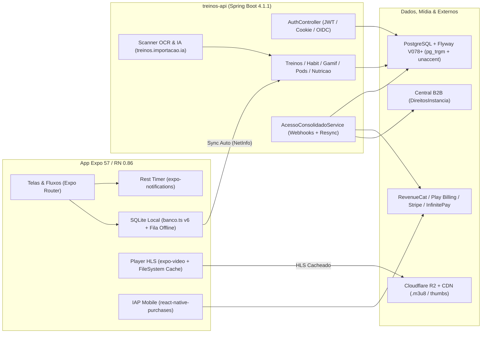
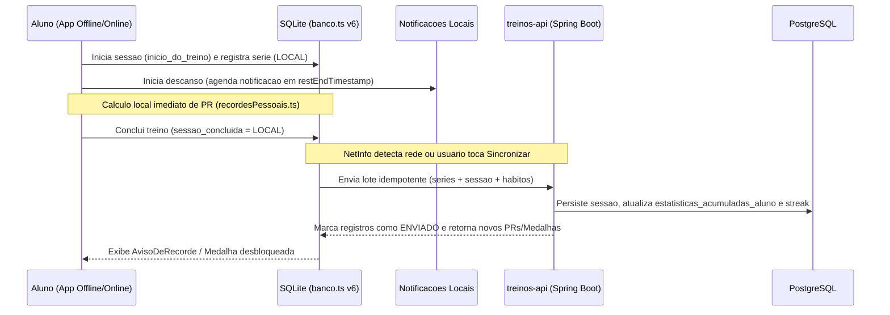

# Plano Mestre de Aplicação Arquitetural e Evolução — `consultoria-app` × STNDRD (`uni.cbum`)

**Data de consolidação:** 2026-11-16  
**Referência analisada:** STNDRD (`uni.cbum` v4.1.65 / `versionCode` 1032, extraído via ADB de Samsung Galaxy S25 Ultra `SM-S938B` e analisado com REA, `apktool`, `jadx-headless-mcp` e inspeção do snapshot AOT `libapp.so` + bundles web `stndrd.app` / `checkout.stndrd.app`).  
**Alvo de aplicação:** `consultoria-app` (Backend `treinos-api` em Spring Boot 4.1.1 / Java / PostgreSQL + Flyway até `V077` + Cloudflare R2/S3; App `app/` em Expo SDK 57 / React Native 0.86.3 / Expo Router / `expo-sqlite` / Tailwind v4).

> **Nota de escopo:** Este documento consolida exclusivamente engenharia arquitetural, interoperabilidade e plano de evolução para o `consultoria-app`. Nenhum código-fonte do `consultoria-app` foi alterado nesta etapa.

---

## 1. Resumo Executivo & Diagnóstico Comparativo (`consultoria-app` vs. STNDRD `uni.cbum`)

O **STNDRD (`uni.cbum`)** é construído em **Flutter** (Dart `3.13.7` AOT, Impeller habilitado, 1.371 arquivos Dart em `package:stndrd`), apoiado por **Firebase (`stndrd-ea1bf`)** (Auth, Firestore reativo sem WebSockets, Storage, Remote Config, FCM), **8 microsserviços Google Cloud Run**, **RevenueCat + Google Play Billing 8.3.0 + Stripe Web Checkout**, **Algolia**, **FatSecret / Studio93 / Google Generative AI + MLKit OCR**, **ExoPlayer HLS** e **Drift/SQLite**.

O **`consultoria-app`** já possui uma fundação de engenharia superior em custo previsível, controle de dados e multi-tenancy (`consultoria_id`): backend **Spring Boot 4.1.1 + PostgreSQL/Flyway**, autenticação segura (`AuthController` com cookie `HttpOnly` na web e `expo-secure-store` via `X-Treinos-Cliente: nativo` no mobile, MFA, Turnstile), infraestrutura **S3/Cloudflare R2**, cliente de IA já configurado (`treinos.importacao.ia`), motor offline transacional em `app/src/offline/banco.ts` (`VERSAO_ESQUEMA = 5`), recordes pessoais offline (`src/dominio/recordesPessoais.ts`), comunidade (`V065`–`V072`) e integração B2B de direitos com a Central.

O plano abaixo traduz os diferenciais de produto, retenção, fluidez e monetização do STNDRD diretamente para a stack real do `consultoria-app`, evitando *vendor lock-in* (sem Firebase/Firestore/Algolia).

### Tabela Mestra: STNDRD (`uni.cbum`) → Onde Aplicar no `consultoria-app`

| Pilar | Referência no STNDRD (`uni.cbum`) | Estado Atual no `consultoria-app` | Onde e Como Aplicar no `consultoria-app` |
|---|---|---|---|
| **Design System & Execução de Treino** | Dark high-contrast, `ResumeWorkoutCubit`, `SwapExercise`, `/intensifierDictionaryPage`, `wakelock_plus` | `src/tema/tokens.ts` (`#0A0A0C`/`#18181B`), `sessao/[uid]/[exercicio].tsx`, `CartaoSerieComEtapas.tsx`, `inicio_do_treino` | Banner `ResumeWorkoutBanner` em `src/app/aluno/index.tsx`, `SwapExerciseSheet` na sessão sem mutar plano publicado, modal inline de técnicas, `expo-haptics` + `expo-keep-awake` |
| **Recordes & Estatísticas** | `lifetimeStats`, `backfillPersonalRecords`, `backfillWorkoutSummaries`, `exerciselastlogdate`, `/personalRecordCelebrationPage` | `RecordesPessoais.java` e `src/dominio/recordesPessoais.ts` (`MAIOR_CARGA`, `MAIS_REPETICOES`, `MAIOR_VOLUME`), `AvisoDeRecorde.tsx` | Migration `V079` (`estatisticas_acumuladas_aluno`, `recorde_pessoal_evento`), endpoints `GET /aluno/estatisticas/lifetime`, `GET /aluno/treinos/ultimos-logs` e `POST /aluno/recordes/backfill` |
| **Hábitos & Gamificação** | `feature/habit_tracker/` (pilares), `feature/gamification/` (`Medal`, `UserAchievement`, `LeaderboardResponse`), streaks | `CartaoAguaDoDia.tsx`, `agua_do_dia` no SQLite, `conquista_aluno` (`V065`), `CartaoCiclo.tsx` | Migration `V078` (`habito_definicao`, `habito_registro_diario`, `habito_streak_resumo`), evolução de `conquista_aluno` com tiers, `MedalsVault` e bloco `lifetimeStats` em `conta.tsx` |
| **Comunidade, Pods & Referrals** | `feature/pods/`, `feature/referral_program/` (`stndrd.onelink.me`), `feature/shareables/` (overlay em foto) | `src/comunidade/` (mural, enquetes, reações, aulões), `src/app/convite.tsx`, `exportarCartao.ts` | Migrations `V080` (`comunidade_pod`, `comunidade_pod_membro`) e `V081` (`indicacao_codigo`, `indicacao_conversao`), App Links (`expo-linking`), shareables com overlay sobre foto |
| **Nutrição Completa & Busca** | Diário + macros, `Algolia` (`foods`, `exercises_name`), `mobile_scanner`, MLKit OCR (`libmlkit_google_ocr_pipeline.so`), `nutrition-scanner-api`, voz | `src/app/aluno/dieta.tsx`, `lista-de-compras.tsx`, `biblioteca` (`Alimento`, `Exercicio`), `treinos.importacao.ia` (Gemini/Claude) | Migration `V082` (`alimento_codigo_barras`, `diario_alimentar_entrada`), busca **`pg_trgm` + `unaccent` + GIN** em PostgreSQL, `expo-camera` (EAN/GTIN + OCR), `expo-speech-recognition`, `POST /aluno/nutricao/scanner-rotulo` e `/log-ia` |
| **Mídia & Vídeos** | `media.cdn.stndrd.app` + ExoPlayer HLS (`.m3u8`) + `DownloadWorkoutCubit` (`/downloadedWorkouts`) | `src/dominio/video.ts` (YouTube `youtube-nocookie.com`), `pom.xml` já tem AWS S3 SDK (Cloudflare R2 / MinIO) | Pipeline HLS (`.m3u8` + `.ts`) no **Cloudflare R2 + CDN**, player `expo-video` em loop mudo e pré-cache offline via `expo-file-system` |
| **Offline & Rest Timer** | `sqflite` (`ResumeWorkoutRepository`, `SessionLogsRepository`), `flutter_local_notifications` + `USE_EXACT_ALARM`, `connectivity_plus` | `src/offline/banco.ts` (`VERSAO_ESQUEMA = 5`, fila `LOCAL\|ENVIADO\|FALHOU`), `sincronizacao.ts`, `BarraDescanso.tsx` | Evoluir `banco.ts` para `VERSAO_ESQUEMA = 6` (`habito_do_dia`, `diario_alimentar`, `catalogo_local_busca`), sync automático via `@react-native-community/netinfo`, Rest Timer por `restEndTimestamp` + `expo-notifications` |
| **Integrações do Aparelho** | `HealthDataSdkService` / `MethodChannel("uni.cbum/channel")`, CameraX, `speech_to_text` (sem BLE no manifesto/bytecode) | `expo-image-picker`, `expo-notifications`, `expo-haptics`, `expo-keep-awake` | `react-native-health-connect` / Apple HealthKit (opt-in), `expo-camera` + `expo-speech-recognition`; manter app sem permissões BLE até existir feature real (com interface `MonitorCardiacoService` pronta) |
| **Auth, Assinaturas Híbridas & Flags** | Firebase Auth + RevenueCat + Play Billing `8.3.0` + Stripe (`checkout.stndrd.app`) + `/customer/getSubscription` + `/admin/revcat-resync` + Remote Config | `AuthController` (cookie/native), `IntegracaoController` (Direitos B2B), `pagamentos` (InfinitePay), `GET /eu` / `GET /publico/configuracao` | OAuth social opcional (`/auth/oauth/*`), `V083` (`assinatura_usuario`, `assinatura_evento_webhook`), `AcessoConsolidadoService`, `react-native-purchases` + webhooks Stripe/InfinitePay/RevenueCat, flags em `GET /eu`, `@sentry/react-native`, `.aab` + Hermes + R8 |

---

## 2. Design System, UX & Execução de Treino sem Fricção

O `consultoria-app` já adota estética *dark-first* de alto contraste em `app/src/tema/tokens.ts` (`ESCURO.fundo: '#0A0A0C'`, `superficie: '#18181B'`, `texto: '#F4F4F5'`, tipografia `Geist`, `Bebas Neue` e `Oswald`, `RAIO = 12`, `RAIO_CONTROLE = 8`). Para atingir a fluidez operacional do STNDRD sem quebrar a identidade visual existente:

1. **Retomada de Sessão (`ResumeWorkoutBanner`):**
   * Reaproveitar a tabela `inicio_do_treino` já presente em `app/src/offline/banco.ts` para renderizar um card fixo no topo de `app/src/app/aluno/index.tsx` (*"Treino em andamento — Continuar"*) sempre que houver séries gravadas sem registro correspondente em `sessao_concluida`.
2. **Logger de Séries de Baixa Fricção (`app/src/app/aluno/sessao/[uid]/[exercicio].tsx`):**
   * Manter `CampoDeCarga.tsx` e `AjusteDeCarga.tsx` com atalhos de incremento (`+2,5 kg` / `+5 kg`) e pré-preenchimento visual da última marca (`src/dominio/seriesAnteriores.ts` / `dicaDeCarga.ts`).
   * Acionar `expo-haptics` (`ImpactFeedbackStyle.Light`) ao concluir cada série e manter `useKeepAwake()` (`expo-keep-awake`) ativo exclusivamente durante a tela de execução.
3. **Troca Rápida de Exercício (`SwapExerciseSheet`):**
   * Permitir substituição temporária de um exercício (ex.: aparelho ocupado na academia) por equivalentes pré-vinculados pelo treinador ou buscados por grupo muscular/equipamento.
   * A substituição é gravada apenas no log da sessão em curso, **preservando a imutabilidade do plano publicado**.
4. **Dicionário Inline de Técnicas/Intensificadores:**
   * Exibir um *bottom sheet* explicativo diretamente ao tocar no badge da série (Drop-Set, Rest-Pause, Cluster, Bi-Set), equivalente ao `/intensifierDictionaryPage` do STNDRD.

---

## 3. Hábitos, Gamificação, Comunidade (Pods), Referrals e Perfil

### 3.1 Regras de Negócio & UI (`app/`)
* **Hábitos Diários por Pilares (`src/dominio/habitos.ts` + `src/aluno/habitos/`):** generalizar o padrão de `CartaoAguaDoDia.tsx` para pilares configuráveis (Hidratação, Sono, Passos/Cardio, Suplementação, Mobilidade), com check-in em 1 toque.
* **Recordes Pessoais (`PRs`), `lifetimeStats` e `MedalsVault`:**
  * Evoluir `src/dominio/recordesPessoais.ts` e `AvisoDeRecorde.tsx` para exibir um sheet pós-treino de celebração quando um novo PR for batido e gráfico de evolução por exercício em `src/app/aluno/historico.tsx`.
  * Exibir bloco `lifetimeStats` no topo de `CartaoMeuPerfil.tsx` / `src/app/aluno/conta.tsx` (treinos concluídos, tonelagem total em kg, total de PRs e maior streak) e galeria de medalhas (`MedalsVault` em `react-native-svg`) com tiers (Bronze/Prata/Ouro).
  * **Streaks:** contagem de dias consecutivos com suporte a *freeze* semanal ou dias de descanso programados no plano.
* **Comunidade (Pods), Referrals & Shareables:**
  * **Pods (`src/comunidade/`):** subgrupos temáticos ou de desafio dentro da mesma `consultoria_id` com ranking semanal opt-in (reaproveitando `participa_ranking_forca` de `V065`).
  * **Referrals (`src/app/convite.tsx` + `expo-linking`):** código de indicação aluno → amigo com deep link rastreável e recompensa automática (ex.: dias extras ou *freeze* de streak) após conversão.
  * **Shareables (`src/aluno/cartao/`):** evoluir `exportarCartao.ts` para gerar cards transparentes/overlays sobre foto tirada na hora (`expo-camera` / `expo-image-picker`) com resumo do treino ou PR batido.

### 3.2 Modelagem PostgreSQL (Flyway `V078`–`V081`)
* **`V078__habitos_e_streaks.sql`:**
  * `habito_definicao` (`id UUID PK`, `consultoria_id UUID FK`, `aluno_id UUID FK`, `titulo VARCHAR(120)`, `categoria VARCHAR(40)`, `meta_diaria INT`, `unidade VARCHAR(30)`, `ativo BOOLEAN`, `criado_em TIMESTAMPTZ`)
  * `habito_registro_diario` (`id UUID PK`, `habito_id UUID FK`, `aluno_id UUID FK`, `data DATE`, `valor INT`, `concluido BOOLEAN`, `atualizado_em TIMESTAMPTZ`, `UNIQUE (habito_id, data)`)
  * `habito_streak_resumo` (`aluno_id UUID PK`, `streak_atual INT`, `maior_streak INT`, `freezes_disponiveis INT DEFAULT 0`, `freezes_usados INT DEFAULT 0`, `ultimo_dia_valido DATE`)
* **`V079__gamificacao_lifetime_e_prs.sql`:**
  * Evolução de `conquista_aluno` (`V065`) com `progresso_atual INT`, `meta INT`, `nivel INT DEFAULT 1`.
  * `estatisticas_acumuladas_aluno` (`aluno_id UUID PK`, `treinos_concluidos INT`, `series_concluidas INT`, `volume_total_kg NUMERIC(14,2)`, `tempo_total_segundos BIGINT`, `total_prs INT`, `atualizado_em TIMESTAMPTZ`).
  * `recorde_pessoal_evento` (`id UUID PK`, `consultoria_id UUID FK`, `aluno_id UUID FK`, `exercicio_id UUID`, `tipo VARCHAR(30)`, `carga NUMERIC(8,2)`, `repeticoes INT`, `valor NUMERIC(12,2)`, `atingido_em TIMESTAMPTZ`).
* **`V080__comunidade_pods.sql`:**
  * `comunidade_pod` (`id UUID PK`, `consultoria_id UUID FK`, `nome VARCHAR(100)`, `descricao TEXT`, `codigo_convite VARCHAR(16) UNIQUE`, `criador_id UUID FK`, `max_membros INT DEFAULT 20`, `criado_em TIMESTAMPTZ`)
  * `comunidade_pod_membro` (`pod_id UUID FK`, `aluno_id UUID FK`, `papel VARCHAR(20)`, `entrou_em TIMESTAMPTZ`, `PRIMARY KEY (pod_id, aluno_id)`)
* **`V081__indicacoes_referrals.sql`:**
  * `indicacao_codigo` (`id UUID PK`, `consultoria_id UUID FK`, `usuario_id UUID FK`, `codigo VARCHAR(24) UNIQUE`, `criado_em TIMESTAMPTZ`)
  * `indicacao_conversao` (`id UUID PK`, `codigo_id UUID FK`, `indicado_usuario_id UUID FK`, `status VARCHAR(20)`, `origem_link VARCHAR(120)`, `criado_em TIMESTAMPTZ`, `convertido_em TIMESTAMPTZ`)

---

## 4. Nutrição Completa (Diário, Busca Rápida, Barcode, OCR, IA e Voz)

Atualmente `src/app/aluno/dieta.tsx` exibe apenas a prescrição do treinador. Para atingir o fluxo completo do STNDRD respeitando a regra de transparência nutricional:

1. **Diário Alimentar do Aluno (`V082__diario_alimentar_e_scanner.sql`):**
   * `alimento_codigo_barras` (`gtin VARCHAR(32) PK`, `alimento_id UUID FK REFERENCES alimento(id)`, `fonte VARCHAR(30)`, `atualizado_em TIMESTAMPTZ`)
   * `diario_alimentar_entrada` (`id UUID PK`, `consultoria_id UUID FK`, `aluno_id UUID FK`, `data DATE`, `refeicao VARCHAR(40)`, `alimento_id UUID NULL`, `nome_exibicao VARCHAR(160)`, `gramas NUMERIC(8,2)`, `calorias INT`, `proteinas_g NUMERIC(7,2)`, `carboidratos_g NUMERIC(7,2)`, `gorduras_g NUMERIC(7,2)`, `origem VARCHAR(20)` [`MANUAL|BARCODE|OCR|IA_TEXTO|IA_VOZ`], `criado_em TIMESTAMPTZ`)
2. **Busca Rápida Estilo Algolia sem Custo Externo (`GET /biblioteca/busca?q=...&tipo=exercicio|alimento&limit=20`):**
   * Habilitar extensões **`pg_trgm` + `unaccent`** e índices **GIN (`gin_trgm_ops`)** em `exercicio.nome` e `alimento.nome` no PostgreSQL (latência < 30 ms, isolada por `consultoria_id`), replicada no cache local SQLite (`catalogo_local_busca`).
3. **Scanner de Código de Barras, OCR de Rótulo, IA e Voz:**
   * **Barcode:** `expo-camera` (`CameraView` com `barcodeScannerSettings` EAN-13/UPC) consultando `GET /biblioteca/alimentos/barcode/{gtin}` (com fallback opcional para OpenFoodFacts cacheado no PostgreSQL).
   * **OCR & IA Generativa:** `POST /aluno/nutricao/scanner-rotulo` e `POST /aluno/nutricao/log-ia` reutilizando a infraestrutura `treinos.importacao.ia` (`gemini-2.5-flash` / `claude-haiku-5-5` já configurada em `application.yml`, sem expor chaves no app). O retorno estruturado (`AlimentoExtraidoDto`) é sempre exibido com **aviso explícito de estimativa** para conferência e edição manual do aluno antes de salvar.
   * **Voz:** `expo-speech-recognition` para ditar refeições e enviar o texto transcrito ao `/aluno/nutricao/log-ia`.

---

## 5. Mídia/Vídeos HLS & Cache Offline

* **Situação atual:** `src/dominio/video.ts` aceita apenas YouTube (`youtube-nocookie.com`). O backend já inclui `software.amazon.awssdk:s3` no `pom.xml` (Cloudflare R2 em produção / MinIO em testes).
* **Pipeline Alvo (complementar ao YouTube):**
  1. **Streaming HLS (`.m3u8`):** Transcodificar vídeos curtos de execução em HLS (`master.m3u8` + segmentos `.ts` + `thumb.jpg`) no Cloudflare R2 servido via domínio CDN (`treinos.midia.cdn-base-url`) com `Cache-Control: public, max-age=31536000, immutable`.
  2. **Player Nativo (`expo-video`):** Substituir/complementar embeds por `expo-video` (sucessor oficial do `expo-av` no Expo SDK 57) em loop mudo por padrão, evitando interromper a música do aluno.
  3. **Pré-cache Offline:** Usar `expo-file-system` (`createDownloadResumable`) para baixar vídeos `.mp4`/thumbnails dos treinos da semana atual em `FileSystem.cacheDirectory`, além de `expo-image` (`cachePolicy="memory-disk"`).

---

## 6. Sincronização Offline, Persistência Local (`expo-sqlite`) & Notificações Locais

### 6.1 Evolução do `app/src/offline/banco.ts` (`VERSAO_ESQUEMA = 5` → `6`)
Preservando o isolamento por usuário (`treinos-${usuarioId}.db`), a fila transacional (`situacao IN ('LOCAL', 'ENVIADO', 'FALHOU')`, `alterado_em`, `motivo`) e a limpeza no logout (`limparDadosDoAluno.ts`):
* **`habito_do_dia`:** `id TEXT PK`, `habito_id TEXT`, `data TEXT`, `valor INTEGER`, `concluido INTEGER`, `alterado_em TEXT`, `situacao TEXT`, `motivo TEXT`, `UNIQUE (habito_id, data)`.
* **`diario_alimentar`:** `id TEXT PK`, `data TEXT`, `refeicao TEXT`, `nome TEXT`, `gramas REAL`, `calorias INTEGER`, `proteinas_g REAL`, `carboidratos_g REAL`, `gorduras_g REAL`, `origem TEXT`, `alterado_em TEXT`, `situacao TEXT`, `motivo TEXT`.
* **`catalogo_local_busca`:** `id TEXT PK`, `tipo TEXT` (`EXERCICIO|ALIMENTO`), `nome_normalizado TEXT`, `payload_json TEXT`, `atualizado_em TEXT`.
* **Auto-Sync:** Conectar `@react-native-community/netinfo` (já instalado no `package.json`) para disparar `sincronizar()` automaticamente ao recuperar conectividade.

### 6.2 Rest Timer Exato em Background & Tela Bloqueada
Como `setInterval` pausa em background no Android/iOS, implementar o padrão por **timestamp absoluto** (sem depender de Foreground Service contínuo):
1. Ao iniciar o descanso, salvar `restEndTimestamp = Date.now() + seconds * 1000` e agendar imediatamente uma notificação local em `expo-notifications` (`trigger: { type: SchedulableTriggerInputTypes.DATE, date: new Date(restEndTimestamp) }`, canal Android `rest-timer` com som e vibração).
2. Ao ajustar (`+15s` / `-15s`) ou pular o descanso, cancelar o `notificationId` anterior e reagendar.
3. Ao retornar ao foco (`AppState === 'active'`), recalcular `Math.max(0, Math.ceil((restEndTimestamp - Date.now()) / 1000))`.

---

## 7. Integrações do Aparelho (Health Connect, Câmera/OCR, Voz e BLE)

1. **Health Connect (Android) & Apple Health (iOS):**
   * Integração opt-in em `src/app/aluno/conta.tsx` via `react-native-health-connect` (Android) / HealthKit (iOS) para **ler** passos/gasto calórico/peso e **gravar** sessões concluídas (`ExerciseSessionRecord`).
   * Requer declaração de `VIEW_PERMISSION_USAGE` / `ACTION_SHOW_PERMISSIONS_RATIONALE` no `AndroidManifest.xml` (via Config Plugin) e aviso de privacidade LGPD.
2. **Câmera, Barcode, OCR e Voz:**
   * Permissões `CAMERA` (`expo-camera`) e `RECORD_AUDIO` (`expo-speech-recognition`) solicitadas exclusivamente sob demanda no momento do uso.
3. **Bluetooth / BLE ("Dispositivos por perto"):**
   * **Constatação factual no STNDRD (`uni.cbum`):** A inspeção estática do `AndroidManifest.xml` e do bytecode Dalvik (`smali*`) confirmou que o STNDRD **não** declara `BLUETOOTH_SCAN`, `BLUETOOTH_CONNECT`, `BLUETOOTH_ADVERTISE` nem `NEARBY_WIFI_DEVICES`, e não utiliza `BluetoothAdapter`/`BluetoothGatt` (apenas enums de áudio `bluetoothSco`/`bluetoothA2dp`).
   * **Diretriz para o `consultoria-app`:** Manter o app livre de permissões Bluetooth até que haja uma feature real (ex.: cinta cardíaca BLE com GATT Heart Rate Service `0x180D`). Quando implementada, isolar atrás de uma interface (`MonitorCardiacoService`) usando `react-native-ble-plx` com `android:usesPermissionFlags="neverForLocation"` em `BLUETOOTH_SCAN`.

---

## 8. Backend, API, Autenticação, Assinaturas Híbridas, Flags, Telemetria & Empacotamento Android

### 8.1 Novos Endpoints REST no `treinos-api`
| Equivalente STNDRD | Endpoint no `treinos-api` | Função |
|---|---|---|
| `workoutsV2` | `GET /aluno/treinos/v2` (`ETag` / `If-None-Match`) | Pacote consolidado do plano ativo, sessões, últimos logs e URLs HLS |
| `exerciselastlogdate` | `GET /aluno/treinos/ultimos-logs?exercicioIds=...` | Consulta batch evitando N+1 na tela de execução |
| `lifetimeStats` | `GET /aluno/estatisticas/lifetime` | Estatísticas acumuladas (`estatisticas_acumuladas_aluno`) + streak |
| `backfillPersonalRecords` / `Summaries` | `POST /aluno/recordes/backfill` e `POST /admin/treinos/backfill-resumos` | Recálculo idempotente de PRs e resumos históricos |
| `loggedDaysNutritionHistory` | `GET /aluno/nutricao/dias-registrados?inicio=...&fim=...` | Totais diários de kcal/macros e aderência à meta |
| `nutrition-scanner-api` | `POST /aluno/nutricao/scanner-rotulo` e `POST /aluno/nutricao/log-ia` | Extração estruturada via `treinos.importacao.ia` (Gemini/Claude) |
| `Algolia` | `GET /biblioteca/busca?q=...&tipo=...&limit=20` | Busca rápida via PostgreSQL `pg_trgm` + `unaccent` + GIN |

### 8.2 Autenticação e Assinaturas Híbridas (`V083__assinaturas_hibridas.sql`)
* **Autenticação:** Manter `AuthController` (cookie `HttpOnly` na web + `X-Treinos-Cliente: nativo` / `expo-secure-store` no app, MFA e Cloudflare Turnstile). Opcionalmente adicionar `POST /auth/oauth/google` e `/auth/oauth/apple` validando `id_token` OIDC via JWKS server-side.
* **Assinaturas Híbridas (Central B2B + Web Checkout + Mobile IAP):**
  * Tabelas `assinatura_usuario` (`provedor`: `REVENUECAT|STRIPE|INFINITEPAY|CENTRAL`, `entitlement`, `status`, `trial_usado`, `expira_em`) e `assinatura_evento_webhook` (`evento_id_externo UNIQUE` para idempotência).
  * `AcessoConsolidadoService` unifica `DireitosInstancia` (B2B da Central) + `assinatura_usuario` (B2C), expondo o status em `GET /eu` e `GET /eu/assinatura` (equivalente ao `/customer/getSubscription`).
  * **Web Checkout:** `POST /publico/checkout/sessao` + `POST /eu/assinatura/verificar-trial` (`/customer/check-trial-used`) + webhooks Stripe/InfinitePay.
  * **Mobile IAP:** `react-native-purchases` (RevenueCat no `expo-dev-client`) + webhook `POST /publico/webhooks/revenuecat` + `POST /eu/assinatura/ressincronizar` (equivalente ao `/admin/revcat-resync`).

### 8.3 Feature Flags, Telemetria, Push e Empacotamento Android
* **Feature Flags:** Centralizar em `ConfiguracaoRecursosService` (variáveis `treinos.recursos.*` + overrides por `consultoria_id`) devolvendo em `GET /eu` o objeto `recursos: { habitos, gamificacao, pods, referrals, scannerNutricaoIa, checkoutWeb, buscaTrgm }`.
* **Telemetria & Crash Reporting:** Adicionar `@sentry/react-native` (integrado ao `plataforma-comum-monitoramento`) e endpoint próprio `POST /telemetria/eventos` recebendo lotes offline do SQLite (sem dependência de Mixpanel/Beacon/AppsFlyer externos).
* **Push & Deep Links:** Expandir `TipoDeAvisoPush` (`STREAK_EM_RISCO`, `PR_BATIDO_NO_POD`, `TRIAL_EXPIRANDO`, `RETORNO_TREINADOR`) com payload `{ rota, tipo, entidadeId }` para roteamento no `expo-router`, e configurar Android App Links (`autoVerify: true`) + iOS Associated Domains.
* **Empacotamento Android (`.aab` / Splits / Hermes / R8):** Publicar via **Android App Bundle (`.aab`)** no EAS Build (geração automática de splits por ABI `arm64-v8a`, densidade e idioma pela Play Store), com **Hermes**, **R8/ProGuard** (`enableProguardInReleaseBuilds`, `enableShrinkResourcesInReleaseBuilds`) e **EAS Update** (`expo-updates`) para correções OTA na camada JS.

---

## 9. Diagramas de Arquitetura e Roadmap Prático

### 9.1 Arquitetura Alvo (`consultoria-app`)

### 9.2 Fluxo Offline-First de Execução, PRs e Gamificação

### 9.3 Roadmap Prático em 3 Fases

| Fase | Foco | Entregas Principais |
|---|---|---|
| **Fase 1 — Quick Wins de Execução & Observabilidade** | Retenção imediata na academia e qualidade de release | `ResumeWorkoutBanner` (usando `inicio_do_treino`), `expo-keep-awake` + `expo-haptics` na execução, Rest Timer por timestamp absoluto (`expo-notifications`), dicionário inline de técnicas, auto-sync com `NetInfo`, `@sentry/react-native` e build `.aab` com Hermes + R8. |
| **Fase 2 — Core Retenção, Gamificação & Nutrição** | Engajamento diário e novos módulos de valor | Migrations `V078`–`V082` + `banco.ts` v6: Hábitos por pilares + Streaks com *freeze*, `lifetimeStats` + `MedalsVault` + histórico de PRs, Pods + Referrals (`expo-linking`) + Shareables com foto, Diário Alimentar + busca `pg_trgm`/`unaccent` + Barcode (`expo-camera`) + Scanner OCR/IA/Voz (`treinos.importacao.ia`). |
| **Fase 3 — Mídia HLS, Assinaturas Híbridas & Integrações** | Escala de mídia, monetização e ecossistema | Transcodificação HLS (`.m3u8`) no Cloudflare R2 + `expo-video` + download offline de treinos, `V083` (`AcessoConsolidadoService` unificando Central B2B + Web Checkout + RevenueCat IAP), Feature Flags em `GET /eu`, Health Connect / Apple Health (opt-in) e interface preparada para futuro BLE. |
