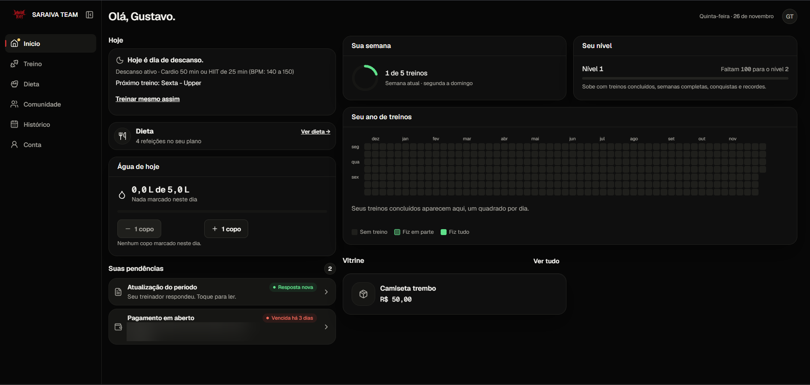
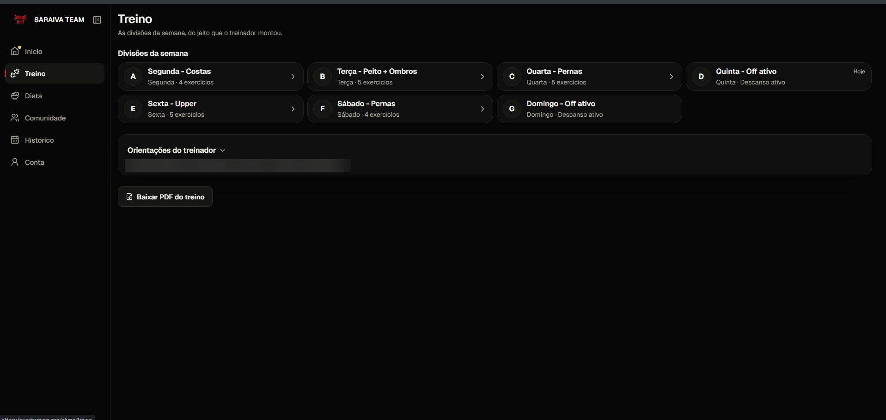
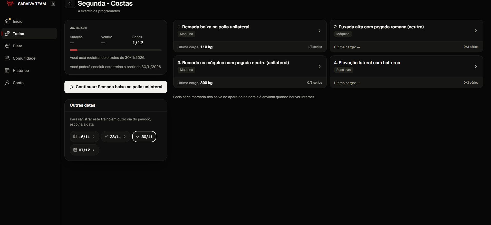
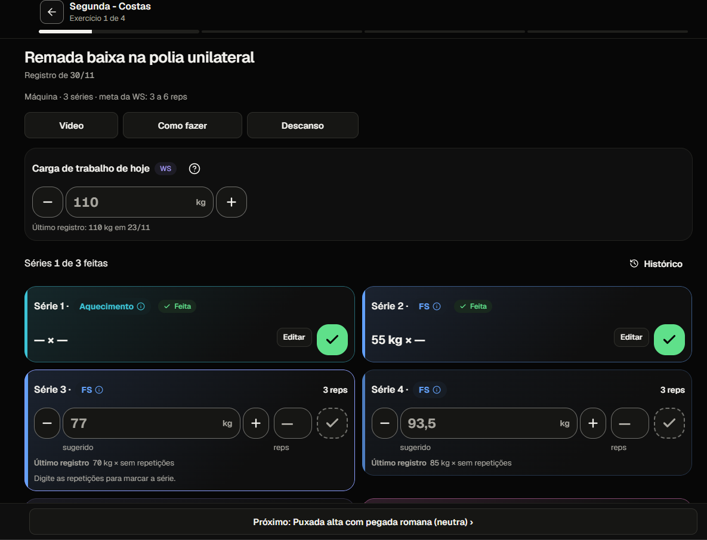
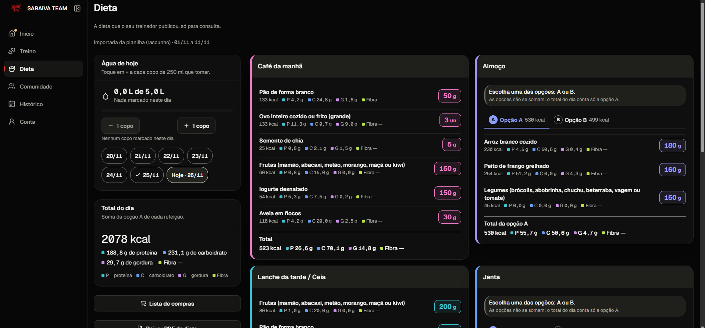
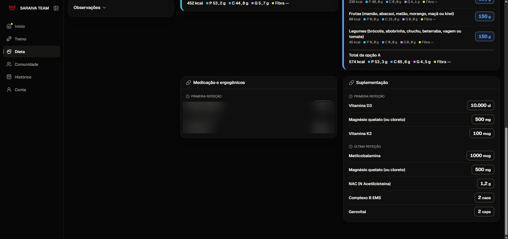
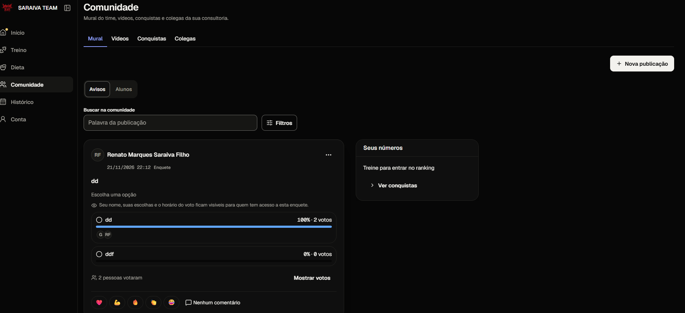
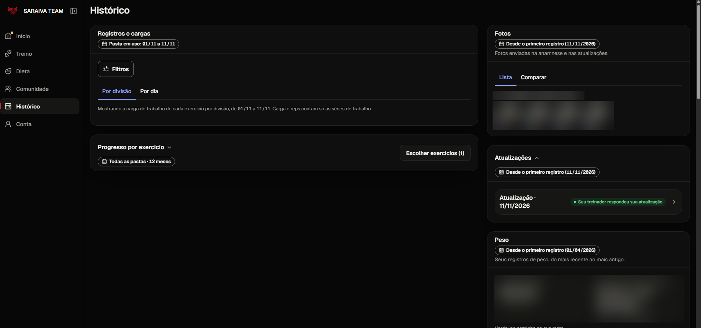
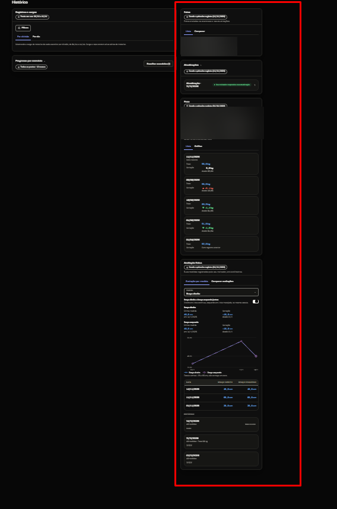

# App do aluno na web: reorganizar o layout (pedido do Gustavo de 26/11/2026)

Situação: Planejando (análise e recomendações, nada implementado) · Onde: `main` · Atualizado: 26/11/2026

Briefing para outra IA executar. As capturas estão em [`aluno-web-layout/`](aluno-web-layout/), tiradas em 1920 px com o
menu aberto e o tema escuro. Remédios, fotos de corpo, peso, objetivo e o valor da cobrança foram borrados (dado sensível
não vai ao git).

**O que o Gustavo pediu:** "Agora temos dois layouts para o aluno, celular e web, mas a versão web está muito feia. Pode
manter os campos, porque eu gostei bastante, mas deveria reorganizar as coisas, deixar mais correto."

Ou seja: **mesmo conteúdo, mesmos campos, mesmas regras; muda só a organização da tela na web larga.** O celular não muda.

**Antes de começar:** leia o `AGENTS.md` (item "Tela larga" e "Tela larga, revisão 2"), a seção 4.10 de
`docs/design-e-front.md` e [tela-larga-revisao-app-do-aluno.md](tela-larga-revisao-app-do-aluno.md): as decisões D1 a D7
de lá (teto de 1688 px em três faixas de 552, grade de cartões de célula mínima 360, três colunas no Início) **são o que
o Gustavo está achando feio agora**. Elas podem ser revistas; as regras de base da 4.10 continuam valendo (espaço extra
vira colunas, nunca elemento esticado; medir a área de conteúdo, não a janela). Se tiver dúvida, pergunte ao Gustavo numa
rodada só, com a opção recomendada primeiro.

Relacionado: [atualizacao-pasta-e-questionarios.md](atualizacao-pasta-e-questionarios.md) (a leitura das respostas da
atualização, bloco B de lá, também aparece no aluno; não reorganize essa tela aqui, ela é daquele plano).

## Diagnóstico geral

O problema não é falta de espaço, é **falta de hierarquia e de ordem de leitura**:

1. **Colunas de alturas muito diferentes**: uma coluna termina cedo e a outra desce muito, sobrando blocos pretos enormes
   (Histórico, Dieta, Treino). A grade distribui cartões por "cabe na coluna", não por importância nem por ordem.
2. **A ordem de leitura se perde**: refeições da dieta em zigue-zague entre duas colunas (Café → Almoço → Lanche → Janta),
   séries do exercício em duas colunas (1, 2 / 3, 4), o que é sequencial deveria ser lido de cima para baixo.
3. **Nada diz "comece aqui"**: no Início, "Hoje", "Pendências" (com cobrança vencida e resposta nova do treinador) e
   "Seu ano de treinos" têm o mesmo peso; o mais urgente (pendências) fica no rodapé da coluna da esquerda.
4. **Ações soltas**: "Baixar PDF do treino", "Nova publicação", "Ver tudo" da vitrine, "Lista de compras" ficam longe do
   que fazem ou boiando fora de cartão.
5. **Cartões grandes para pouco conteúdo** ("Sua semana", "Seu nível", "Seu ano de treinos" quase vazio) e conteúdo denso
   espremido (macros da dieta, cartões de série).

## Princípios para a reorganização (valem para todas as telas)

- **Uma coluna principal + uma coluna de apoio** (como o mural já faz com `MuralComLateral`): a principal leva o que se lê
  em ordem (refeições, séries, divisões, feed); a de apoio, fixa ao rolar, leva resumos e ações (totais, água, PDF, lista
  de compras, números). Evita colunas de alturas aleatórias.
- **O que é sequencial fica numa coluna só**, de cima para baixo (refeições, séries, exercícios do dia).
- **Largura total da composição limitada e centralizada** quando não há conteúdo para mais colunas (nada de um feed de
  720 px colado à esquerda com 800 px vazios à direita).
- **Topo com o que pede ação primeiro** (pendências, treino de hoje), números e gráficos depois.
- **Ação perto do que ela faz**: a ação principal da tela no cabeçalho dela; ações de um bloco no cabeçalho do bloco.
- Nenhum campo, texto, regra ou rota muda. Só layout, ordem e agrupamento. Celular igual ao de hoje (só conferir que não
  quebrou).
- Regra de layout pura em `dominio/` (como `telaLargaDoAluno.ts`, `arranjoDoInicio.ts`, `arranjoDoMural.ts`), com teste,
  e a tela só aplica.

---

## 1. Início (`app/src/app/aluno/index.tsx`, `dominio/arranjoDoInicio.ts`)

**O que está ruim:** três colunas sem relação entre si; "Suas pendências" (cobrança vencida, resposta do treinador) no fim
da primeira coluna; "Sua semana" e "Seu nível" são cartões largos com uma linha cada; "Seu ano de treinos" ocupa a maior
área da tela com quase nada marcado; a "Vitrine" boia com o "Ver tudo" fora do cartão; metade de baixo da tela vazia.

**Recomendação:**
- Linha 1 (o que fazer hoje): **Hoje** (treino ou descanso, com o próximo treino) largo à esquerda e **Suas pendências** à
  direita, na mesma altura.
- Linha 2 (o dia): **Dieta** (resumo) e **Água de hoje** lado a lado.
- Linha 3 (progresso): **Sua semana** e **Seu nível** juntos num cartão só ou lado a lado em cartões baixos (são indicadores,
  podem usar `ui/CartaoDeIndicador`/`GradeDeIndicadores`).
- Linha 4: **Seu ano de treinos** na largura toda, mais baixo (o mapa já tem célula máxima de 22; o cartão não precisa de
  mais altura que a grade + legenda).
- Vitrine por último, com o "Ver tudo" dentro do cabeçalho do cartão.
- Blocos que não existem (sem retorno, sem vitrine, sem dieta) somem sem deixar buraco: a linha se reajusta.

## 2. Treino (`app/src/app/aluno/treino.tsx`)

**O que está ruim:** grade de 4 divisões no topo e o resto da tela vazio; o dia de hoje só tem o rótulo "Hoje" pequeno;
dias de descanso (D, G) parecem iguais aos de treino; "Orientações do treinador" e "Baixar PDF do treino" soltos embaixo.

**Recomendação:**
- Coluna principal: divisões numa lista vertical (uma linha por dia, na ordem da semana), com **hoje em destaque** (o
  mesmo tratamento do cartão "Hoje" do Início) e os dias de descanso discretos (sem seta, texto suave "Descanso ativo").
- Coluna de apoio: Orientações do treinador (aberta na web, há espaço), "Baixar PDF do treino" e, se houver, a Mobilidade.

## 3. Treino do dia (`app/src/app/aluno/sessao/[uid].tsx`, `aluno/ExerciciosDoDia.tsx`)

**O que está ruim (menos grave):** exercícios em duas colunas embaralham a ordem 1-2 / 3-4; a frase do rodapé fica solta;
os textos "Você está registrando o treino de 30/11" e "Você poderá concluir este treino a partir de 30/11" competem.

**Recomendação:** coluna de apoio à esquerda como hoje (resumo, "Continuar", Outras datas), mas os **exercícios numa
coluna só**, em ordem, com "Última carga" e "N/3 séries" na mesma linha; a nota do salvamento offline vai para dentro do
cartão do resumo. Juntar as duas frases da data em uma.

## 4. Exercício (`app/src/app/aluno/sessao/[uid]/[exercicio].tsx`)

**O que está ruim:** as séries em duas colunas quebram a ordem (Série 1 ao lado da 2, 3 ao lado da 4); "Vídeo", "Como
fazer" e "Descanso" parecem abas mas abrem coisas diferentes; a "Carga de trabalho de hoje" ocupa uma faixa inteira para
um campo; o "Próximo" no rodapé ocupa a largura toda da tela.

**Recomendação:**
- Duas colunas: **à esquerda, fixa ao rolar**, o exercício (nome, meta, vídeo embutido quando houver, "Como fazer" aberto,
  cronômetro de descanso, Histórico); **à direita**, a carga de trabalho de hoje e as **séries numa coluna só**, na ordem.
- Rodapé "Anterior / Próximo" na largura da coluna das séries, não da tela.
- Cartões de série com as cores por tipo (decisão da Frente G) continuam; só a disposição muda.

## 5. Dieta (`app/src/app/aluno/dieta.tsx`, `aluno/DietaDoAluno.tsx`)

| | |
| --- | --- |
|  |  |

**O que está ruim:** refeições em duas colunas em zigue-zague (a ordem do dia se perde); a coluna da esquerda (água, total,
lista de compras, PDF, observações) acaba cedo e deixa um buraco enorme; "Medicação e ergogênicos" e "Suplementação"
ficam no fim, longe do horário em que se tomam; linha de macros muito densa.

**Recomendação:**
- Coluna principal: **refeições numa coluna só, na ordem do dia**, com o horário no cabeçalho; opções A/B como hoje.
- Coluna de apoio, fixa ao rolar: Total do dia, Água de hoje, Suplementação, Medicação e ergogênicos (só quando existir,
  como hoje), Lista de compras, Baixar PDF e Observações.
- Com a área bem larga (faixa `ultralarga`), duas colunas de refeições **só se** a ordem continuar clara (ex.: manhã e tarde
  à esquerda, noite à direita, com o título de cada faixa); senão, uma.
- Macros: manter os valores, com mais respiro (kcal em destaque e P/C/G/Fibra numa linha menor embaixo).

## 6. Comunidade (`app/src/app/aluno/comunidade.tsx`, `dominio/arranjoDoMural.ts`)

**O que está ruim:** feed de 720 px + lateral de 340 px coladas à esquerda e ~600 px vazios à direita; "Nova publicação"
sozinho no canto direito, longe do feed; o seletor Avisos/Alunos, a busca e os filtros em três linhas separadas.

**Recomendação:** **centralizar o bloco feed + lateral** na área; "Nova publicação" no topo do feed (ou na lateral, acima
de "Seus números"); Avisos/Alunos, busca e Filtros numa linha só acima do feed. As abas Vídeos, Conquistas e Colegas
seguem a mesma largura do bloco.

## 7. Histórico (`app/src/app/aluno/historico.tsx`)

| | |
| --- | --- |
|  |  |

**O que está ruim** (a segunda captura, marcada pelo Gustavo, mostra a tela inteira): a coluna da esquerda tem dois cartões
quase vazios e a da direita empilha Fotos, Atualizações, Peso e Avaliação física numa torre muito longa.

**Recomendação:** abas no topo da tela, cada uma com seu próprio arranjo:
- **Treinos**: Registros e cargas (largura principal) + Progresso por exercício.
- **Corpo**: Peso e Avaliação física (gráficos na largura toda) e Fotos (lista e comparar).
- **Atualizações**: a lista das atualizações enviadas.
A aba fica no endereço (`?aba=`, regra de "Voltar" do `AGENTS.md`). Alternativa, se o Gustavo preferir sem abas: duas
colunas equilibradas por altura (`ui/Alvenaria`) com Peso e Avaliação na coluna larga.

## 8. Conta (`app/src/app/aluno/conta.tsx`)

Não veio captura. Já segue a regra de formulário (320 + 640, decisão D6 de
[tela-larga-revisao-app-do-aluno.md](tela-larga-revisao-app-do-aluno.md)): só conferir que combina com o novo padrão
(centralizado, mesma largura máxima das outras telas).

---

## Como executar

- Perfil: `plano-front` (plano da tela inteira do aluno na web, uma passada por todas as telas acima, para o padrão ser um
  só) → `executor-front` (implementa por tela, uma de cada vez, com captura antes e depois).
- Ordem sugerida: Início → Dieta → Exercício → Treino e Treino do dia → Histórico → Comunidade → Conta.
- Peças: reaproveite `aluno/TelaDoAluno`, `useFaixaDaTela`/`useFaixaDeLargura`, `ui/Alvenaria`, `ui/Grade`,
  `GradeDeIndicadores`, `MuralComLateral`. Se surgir um "coluna principal + apoio fixa ao rolar" genérico, ele vai para
  `ui/` e serve às sete telas (e à revisão do treinador do outro plano).
- A prévia "Ver como o aluno" do treinador reaproveita `DietaDoAluno` e os componentes do treino: o arranjo largo continua
  só por prop que a rota do aluno passa (D4 do plano anterior); a folha da prévia não muda.

## Aceite

- Capturas antes e depois de cada tela em 1280, 1920 e 2560 (menu aberto), escuro e claro; 390 sem mudança.
- e2e: `e2e/tela-larga-app-do-aluno.spec.ts` atualizado e os specs das telas tocadas (`inicio-aluno`, `dieta-*`,
  `exercicio-aluno`, `comunidade`, `peso-historico-aluno`…) verdes. Mexe em várias telas: rode a suíte e2e inteira no fim
  (regra do `AGENTS.md` para lote grande).
- typecheck, lint e jest; nenhuma regra de negócio nem rota muda (sem `mvn verify`).
- Registrar no relatório o que não foi conferido (celular nativo não muda, mas confira 390 na web).

## Regras que não podem ser esquecidas

- Mesmos campos e textos (pedido do Gustavo). Nada de remover informação para "limpar".
- Português; um primário por área; seleção invertida; cor da marca só onde já está; sem cor nova.
- Trabalhar na `main`; commit só quando o Gustavo pedir; **push só com ordem dele** (push publica produção).

## Perguntas em aberto para o Gustavo

1. Histórico: abas (Treinos, Corpo, Atualizações) ou uma tela só com duas colunas equilibradas? (recomendação: abas)
2. Dieta: refeições sempre numa coluna só, ou duas colunas na tela muito larga quando a ordem ficar clara? (recomendação:
   uma coluna; duas só na `ultralarga`)

## Passos

- [ ] 1. Plano de tela (`plano-front`) cobrindo as sete telas — commit: —
- [ ] 2. Início — commit: —
- [ ] 3. Dieta — commit: —
- [ ] 4. Exercício — commit: —
- [ ] 5. Treino e Treino do dia — commit: —
- [ ] 6. Histórico — commit: —
- [ ] 7. Comunidade — commit: —
- [ ] 8. Conferência final (Conta, capturas, e2e inteira) — commit: —

## Fora do escopo

- Celular (layout de hoje fica).
- Telas do treinador e a tela da atualização (estão em [atualizacao-pasta-e-questionarios.md](atualizacao-pasta-e-questionarios.md)).
- Mudança de conteúdo, texto ou regra.
