# Atualização, pasta do aluno e questionários (pedido do Gustavo de 26/11/2026)

Situação: Em andamento. A, B, C (API e script), D e E entraram no lote de 26/11 (já na `main`, base `fb57efa9`; registro em
[lote-26-11-retomada.md](lote-26-11-retomada.md)); C1 no app e F no commit local `727957c0` (rodada de 28/11, onda 1, branch
`rodada-28-11`, sem push); D (prescrição da época) e G parcial aplicados na onda 2, **sem commit** · Onde: worktree
`consultoria-app-rodada-28-11` · Atualizado: 27/11/2026 (estado real na seção "Passos")

Este documento é o briefing para outra IA executar. Ele junta o que o Gustavo pediu (um PDF de 23 páginas com capturas),
a análise do código de hoje e o que recomendamos fazer. As capturas estão em
[`atualizacao-pasta-e-questionarios/`](atualizacao-pasta-e-questionarios/). Fotos de corpo e o nome do aluno de teste
foram borrados de propósito (LGPD: foto de corpo nunca vai ao git).

**Antes de começar:** leia o `AGENTS.md` inteiro (regras que não podem ser quebradas, convenções da API e do app), o
`docs/design-e-front.md` (tela) e, para a pasta, [pasta-publicar-copiar-finalizar.md](pasta-publicar-copiar-finalizar.md)
e [copiar-periodo-na-pasta.md](copiar-periodo-na-pasta.md), para não reabrir decisões já tomadas.
**Se tiver dúvida que o código não resolve, pergunte ao Gustavo** (ele pediu isso) em uma rodada só, com a opção
recomendada primeiro.

Relacionado: [aluno-web-layout.md](aluno-web-layout.md) reorganiza o layout do app do aluno na web (Início, Treino,
Dieta, Comunidade, Histórico). A tela de responder e ler a atualização é deste plano (blocos A e B); se surgir lá uma peça
de layout "coluna principal + coluna de apoio", use a mesma aqui na revisão do treinador (bloco D).

## Objetivo

Deixar a atualização (check-in do aluno) mais rápida de responder, mais fácil de ler e de revisar, deixar a pasta do aluno
menos confusa, permitir agendar quando o aluno passa a ver um plano novo e melhorar a criação e a edição dos
questionários (atualização, anamnese e inscrição).

## Decisões do Gustavo (26/11/2026)

| # | Decisão | Valor |
| --- | --- | --- |
| D1 | Data de liberação do plano | Campo no **publicar** (e no **Publicar tudo** da pasta): "Liberar para o aluno em DD/MM". Opcional; vazio = libera na hora. Até a data, o aluno continua vendo o plano anterior. |
| D2 | Aviso da liberação | **O aluno é notificado** quando o plano novo fica disponível (push no celular e aviso dentro do app). |
| D3 | Pergunta de "dias de treino" | Os dias vêm dos **dias que o aluno treinou** no período da atualização (registros no app). Sem registro no período, cai para os dias da semana (seg a dom). |
| D4 | Questionário do Saraiva | **Refazer por script** (como `scripts/questionario/anamnese-saraiva.mjs`), trocando as perguntas de texto por perguntas de tocar. |
| D5 | "Insights" na revisão | **Só o que mudou** desde a atualização anterior, em fatos. Sem julgamento, sem limite inventado, sem cor de "bom" ou "ruim" (regra do `AGENTS.md`: o app não opina nem calcula nada sobre saúde). |
| D6 | Compatibilidade | Não precisa (ainda não há o primeiro cliente): pode apagar, refazer e mudar contrato, dados e telas. |

## Visão geral: os sete blocos

| Bloco | O que é | Tipo de trabalho | Quem executa (perfil) | Depende de |
| --- | --- | --- | --- | --- |
| A | Teclado cobre o campo ao responder | bug em peça compartilhada (`ui/Tela`) | sessão principal (Sonnet) | — |
| B | Leitura das respostas "sem meio nem fim" (aluno e treinador) | ajuste numa peça compartilhada | sessão principal ou `executor-front` | — |
| C | Perguntas de tocar (alimentos, exercícios, dias) + questionário do Saraiva | tipo novo de pergunta (API + app) e script | `executor` | — |
| D | Tela de revisão do treinador (prescrito ao lado, Evolução, "o que mudou") | tela | `plano-front` → `executor-front` | B (e aproveita C) |
| E | Data de liberação do plano + aviso ao aluno | migration, contrato de plano imutável, rotina, push | `executor` + revisão do `revisor` | — |
| F | Folha da pasta do aluno | redesenho de tela | `plano-front` → `executor-front` | E (espaço para a data de liberação) |
| G | Criação e edição de questionários (atualização, anamnese, inscrição) | redesenho de telas | `plano-front` → `executor-front` | C (a galeria de tipos traz o tipo novo) |

Ordem recomendada de sessões: **A + B** → **C** → **E** → **D** → **F** → **G**. A, C e E podem andar em paralelo
(não tocam os mesmos arquivos); D, F e G esperam o que está na coluna "Depende de". Uma migration tem um dono só por vez.

---

## A. Teclado cobre o campo ao responder a atualização (bug)

O que o Gustavo disse: "Quando eu vou escrever o foco não vai direto para o campo de texto, deveria ir."

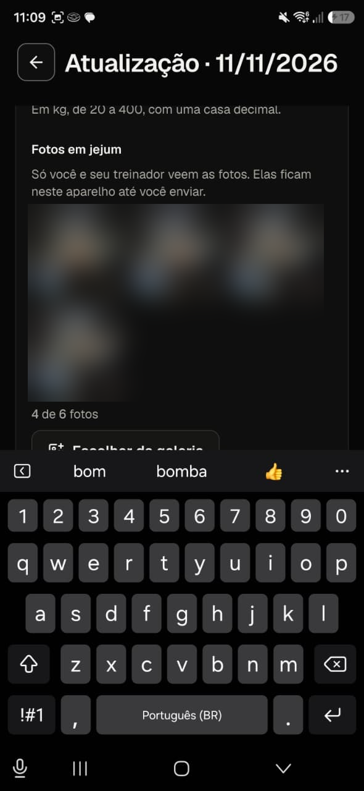

**Análise.** No Android o teclado abre, mas a tela não rola até o campo tocado: o aluno digita sem ver onde. Causa
provável em `app/src/ui/Tela.tsx:57`: `KeyboardAvoidingView behavior={Platform.OS === 'ios' ? 'padding' : undefined}`,
ou seja, **no Android não há ajuste nenhum**, e o Expo SDK 57 é edge-to-edge (o `adjustResize` do Android não resolve
sozinho). A `ui/Folha` tem o próprio `KeyboardAvoidingView`; confira os dois.

**Recomendação.**
1. Consulte o Context7 (Expo SDK 57 / React Native da versão do `package.json`) sobre o jeito recomendado de tratar o
   teclado com edge-to-edge, antes de escolher. Não adicione dependência para isso.
2. Corrija **uma vez** na peça compartilhada (`ui/Tela` e, se preciso, `ui/RolagemComTopo`/`ui/Folha`), não por tela.
3. Confirme que o campo tocado fica visível acima do teclado e que o "Avançar"/"Enviar" não fica escondido.
4. Hipótese a confirmar com o Gustavo no aparelho: "o foco não vai direto" também pode ser o toque no rótulo não focar o
   campo. Se for, o `Campo` deve focar o `TextInput` ao tocar no rótulo.

**Aceite.** No Android e no iOS, tocar em qualquer campo da atualização e da anamnese mostra o campo acima do teclado.
O e2e da web não reproduz o teclado: diga no relatório que o teste foi no aparelho (ou que não foi).

---

## B. Leitura das respostas: "parece que não tem meio nem fim"

O que o Gustavo disse: "Agora para visualizar, tanto para o aluno quanto para o treinador, tem o mesmo problema. Fica
difícil entender o que é cada coisa porque parece que não tem meio e nem fim."

| Aluno (celular) | Aluno (celular) | Aluno (celular) |
| --- | --- | --- |
| 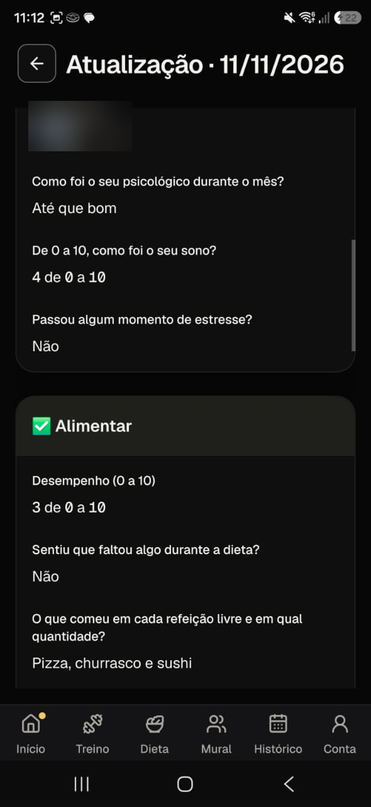 | 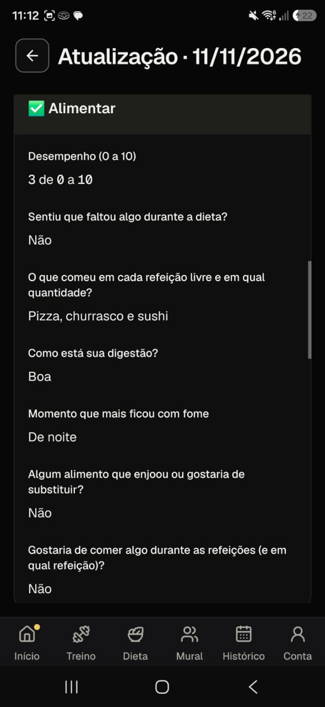 | 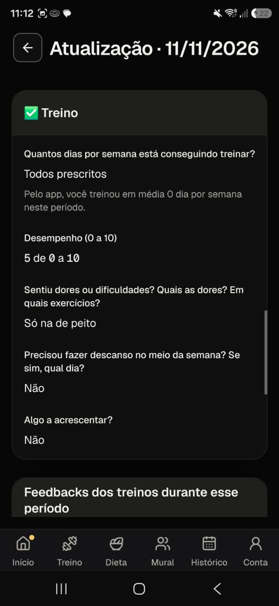 |
| 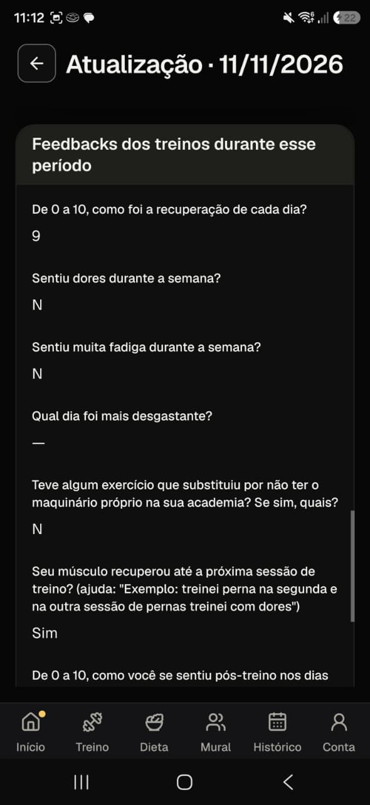 | 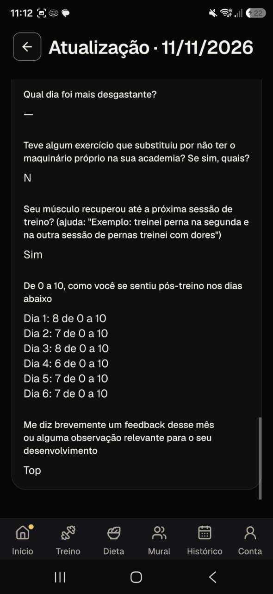 | |

Treinador (web):

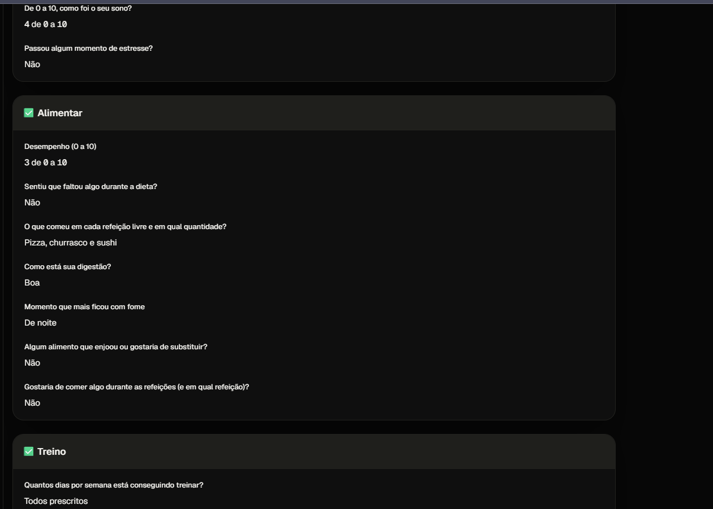

**Análise.** Pergunta e resposta têm quase o mesmo peso visual, e as perguntas seguem uma embaixo da outra sem
separação: o olho não sabe onde termina uma e começa a outra. Outros defeitos visíveis:
- Nota escrita "4 de 0 a 10" mistura fonte mono e normal e é longa; "Dia 1: 8 de 0 a 10" repetido seis vezes.
- Respostas "N" e "Sim/Não" em texto livre (vem do questionário, ver bloco C).
- "Pelo app, você treinou em média 0 dia por semana" (plural errado: "0 dias").
- Resposta vazia vira "—" solto, sem dizer que não foi respondida.

**Recomendação.** Uma única peça de leitura para aluno e treinador (hoje a leitura sai do `QuestionarioAtualizacao` em
modo leitura e de `dominio/atualizacaoQuestionario.textoDaResposta`):
- Cada pergunta é uma linha com divisória embaixo: pergunta em texto pequeno e suave em cima, resposta em texto normal e
  mais forte embaixo. Em tela larga, pergunta à esquerda e resposta à direita, como a `ui/ListaDeDados` (reaproveite essa
  peça em vez de criar outra).
- Seção vira cartão com o título na faixa (já é assim) e a contagem "N perguntas".
- Nota: "4/10" em destaque, com a escala embaixo só quando não é 0 a 10. Notas por dia: tabelinha "Dia 1 … Dia 6" com os
  valores em linha.
- Sim/Não com selo neutro; resposta vazia = "Não respondeu" em texto suave.
- Corrigir o plural da frase do treino.

**Aceite.** e2e da atualização (aluno e treinador) em 390 e 1280, claro e escuro; capturas antes e depois no relatório.

---

## C. Perguntas de tocar e questionário do Saraiva

O que o Gustavo disse: "quanto menos o aluno precisar escrever, mais rápido ele responde". Para cada pergunta de texto,
ele quer algo de clicar, e pediu sugestões onde não sabia como fazer.

| Pergunta de hoje (texto livre) | Pedido do Gustavo | Recomendação |
| --- | --- | --- |
| 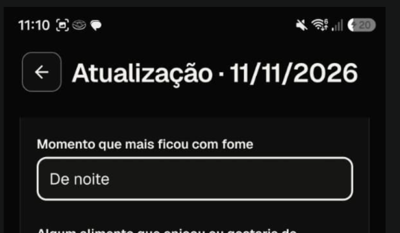 "Momento que mais ficou com fome" | "ter a opção de colocar o período" | **Conteúdo, sem código novo:** `MULTIPLA_ESCOLHA` com "Manhã", "Tarde", "Noite", "Madrugada", "Não senti mais fome que o normal". |
| 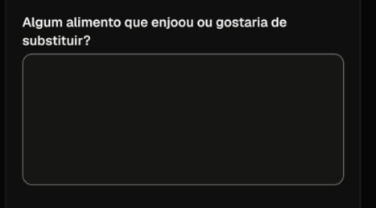 "Algum alimento que enjoou ou gostaria de substituir?" | "Sim/Não; se Sim aparece a lista de alimentos do período, ele clica qual quer substituir e pode pôr um motivo (não obrigatório)" | `SIM_NAO` + (com `mostrarSe` = Sim) **tipo novo** com a fonte "alimentos da dieta", motivo opcional. |
| 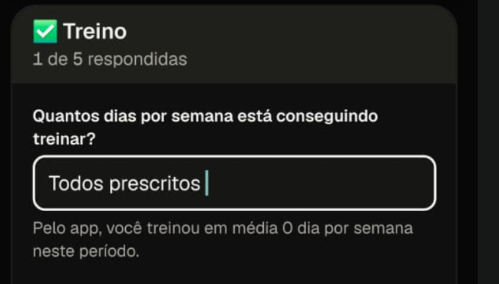 "Quantos dias por semana está conseguindo treinar?" | "alguma forma só de clicar" (pediu sugestão) | `ESCOLHA_UNICA`: "Todos os prescritos", "Faltei 1 dia", "Faltei 2 ou mais". O app já mostra embaixo quantos treinos ele registrou no período; mantenha. |
| 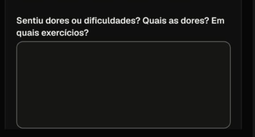 "Sentiu dores ou dificuldades? Em quais exercícios?" | "Sim/Não; se Sim aparece a lista de exercícios" | `SIM_NAO` + tipo novo com a fonte "exercícios do treino", motivo opcional com o rótulo "Onde e como doeu?". |
| 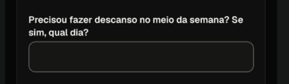 "Precisou fazer descanso no meio da semana? Qual dia?" | "puxar os dias da semana" | `SIM_NAO` + `MULTIPLA_ESCOLHA` com seg a dom (conteúdo, sem código novo). |
| 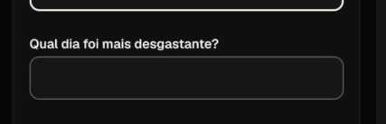 "Qual dia foi mais desgastante?" | "puxar os dias de treino dele no período e sempre pôr um Motivo; o treinador marca se o motivo é obrigatório" | Tipo novo com a fonte "dias treinados" (D3), escolha de **um** item, motivo **obrigatório ou opcional, escolhido pelo treinador** no editor. |
| 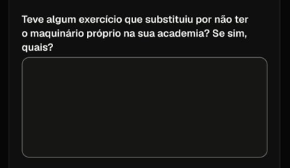 "Teve algum exercício que substituiu por não ter o maquinário? Quais?" | "Sim/Não; se Sim aparece a lista de exercícios; opção de adicionar quais tem na academia e de pôr uma foto" | `SIM_NAO` + tipo novo (exercícios, motivo com o rótulo "O que usou no lugar?") + pergunta `FOTOS` com `mostrarSe` ("Foto do aparelho que você usou", até 2 fotos). **Não** criar cadastro de "máquinas da academia" aqui: a anamnese do Saraiva já tem a seção "Maquinário da academia". |
| 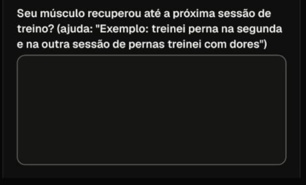 "Seu músculo recuperou até a próxima sessão?" | "não sei o que daria pra fazer, preciso de sugestões" | `SIM_NAO` e, se "Não", tipo novo com a fonte "dias treinados" (várias escolhas): "Em quais treinos você ainda estava dolorido?", motivo opcional. |

**Análise do código.** O app já tem 18 tipos de pergunta (`api/.../questionarios/TipoPergunta.java`, espelho em
`app/src/api/tipos.ts`), incluindo `SIM_NAO`, escolhas, `GRADE`, `FOTOS` e condição `mostrarSe` (pergunta que só aparece
depois de um "Sim"). Metade do pedido é **só conteúdo** do questionário. Falta **um** tipo: escolher itens que vêm do
plano/registros do próprio aluno.

**Recomendação: um tipo novo, genérico** (nome sugerido `ITENS_DO_PLANO`; não crie três tipos):
- Configuração no editor: `fonte` = `ALIMENTOS_DA_DIETA` | `EXERCICIOS_DO_TREINO` | `DIAS_TREINADOS`; `maximo` (1 = escolha
  única, vazio = várias); `motivo` = `NENHUM` | `OPCIONAL` | `OBRIGATORIO` e o rótulo do motivo (até 60 caracteres).
- Lista que o aluno vê:
  - alimentos: os itens distintos da dieta **publicada e vigente na pasta da atualização** (das refeições, opção A e
    alternativas), por nome;
  - exercícios: os exercícios distintos do treino publicado da pasta;
  - dias treinados (D3): os dias com treino registrado no período da pasta (data + nome da sessão, "Seg 17/11 · Treino A");
    sem nenhum registro, seg a dom.
  - O aluno monta a lista **pelo pacote salvo no aparelho e pelos registros locais**, para funcionar sem internet.
- Resposta: lista de `{id, motivo}` (`id` = uid do item na versão do plano, ou a data no caso dos dias). O **servidor**
  confere cada id contra a versão publicada da pasta e grava o nome junto (nome lido da versão, nunca o que o cliente
  mandou), para a resposta continuar legível depois que o plano mudar.
- Onde vale: só na **atualização**. Recusado na anamnese e na inscrição (`ValidadorQuestionario`,
  `FORA_DA_INSCRICAO`/`TIPOS_FORA_DA_INSCRICAO`, `tiposParaAdicionar`).
- O que muda junto (tudo no mesmo lote): `TipoPergunta` (Java) e `tipos.ts`; `ValidadorQuestionario` e
  `ValidadorAtualizacao`; `dominio/questionario.ts`, `dominio/respostasAtualizacao.ts`,
  `dominio/atualizacaoQuestionario.textoDaResposta`; as fixtures de paridade **geradas** por
  `scripts/questionario/gerar-fixtures.mjs` (nunca à mão); renderização de resposta e de leitura (bloco B); prévia do
  editor com itens fictícios ("Frango grelhado", "Supino reto"…); a Evolução das respostas ignora o tipo.
- App antigo mostra "Atualize o app para responder esta pergunta." (já existe para tipo desconhecido). Pede APK novo.
- Dado sensível (dieta e dor): nunca em log, auditoria nem mensagem de erro; mensagens de validação fixas, sem repetir o
  valor; exportação LGPD e anonimização já tratam as respostas da atualização (confira que o motivo entra na limpeza).

**Script do Saraiva (D4).** `scripts/questionario/atualizacao-saraiva.mjs` no molde de `anamnese-saraiva.mjs`
(simula por padrão; `--gravar` salva rascunho, valida e publica; recusa da API restaura o rascunho; idempotente; login
só por ambiente; `acesso-lib.mjs`). Ele reescreve o questionário de atualização padrão do Saraiva com a tabela acima e
mantém o que já é de tocar (notas 0 a 10, peso, fotos). Teste com API falsa em `127.0.0.1`, como os outros scripts.
**Mostre ao Gustavo a lista final de perguntas antes de gravar em produção.**

**Aceite.** `mvn verify` (contrato de API mudou), typecheck, lint, jest e a e2e inteira (regra do `AGENTS.md` para
mudança de contrato), mais o caso novo no e2e da atualização em 390 e 1280.

---

## D. Revisão da atualização pelo treinador

O que o Gustavo disse: "vamos aproveitar esse espaço ou refazer essa tela". "Muitas vezes os treinadores não lembram o que
foi prescrito para o aluno (alimentação, treino, suplementos…); gostaria de um breve resumo nessa tela, ali do lado, para
ele não precisar sair da tela ou abrir outras abas." "Também uma aba para comparar a evolução, praticamente a tela de
Evolução que tem no aluno, e alguns insights, tipo perdeu ou ganhou peso, coisas que fugiram do padrão."

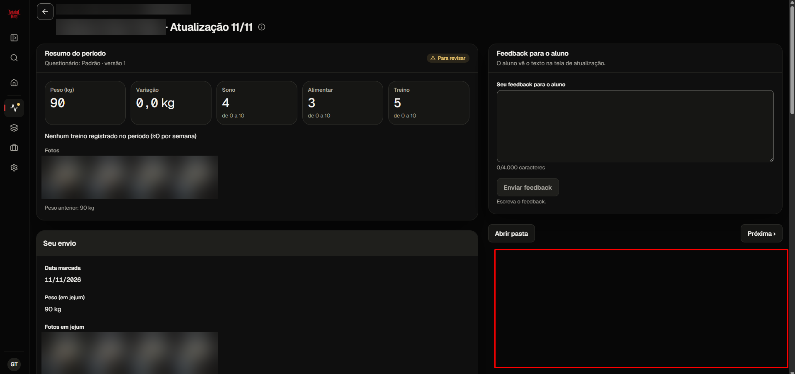

| | |
| --- | --- |
| 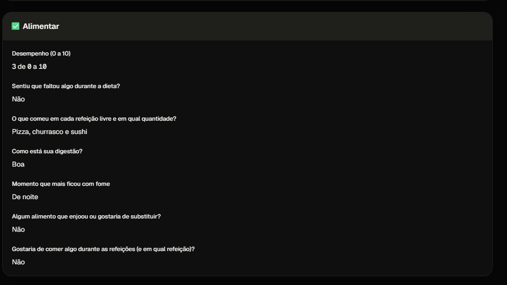 | 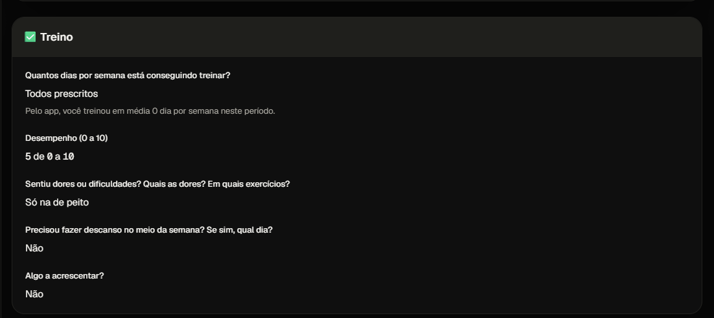 |

**Análise.** A tela é `app/src/app/treinador/atualizacoes/[id].tsx` (com `treinador/ResumoDaAtualizacao`). A coluna da
direita só tem o feedback e "Abrir pasta"/"Próxima"; abaixo disso sobra uma área vazia do tamanho de meia tela.

**Recomendação.**
1. **Coluna da direita fixa ao rolar**, com duas partes: o Feedback (como hoje) e, abaixo, **"O que está prescrito"**: abas
   compactas Treino | Dieta | Suplementos | Outros, mostrando a versão **publicada da pasta desta atualização**:
   - Treino: divisões com os exercícios e as séries resumidas ("Supino reto · 3×6 a 8 · WS").
   - Dieta: refeições com os itens e as quantidades, total do dia e água.
   - Suplementos: nome, dose e horário.
   - Outros (medicação e ergogênicos): **só com `ERGOGENICO_LER`**.
   - Cada aba atrás da permissão que já mostra aquele dado (`TREINO_LER`, `DIETA_LER`); sem permissão, a aba some.
   - Reaproveite as regras e peças do "Ver como o aluno" (`dominio/previaDoAluno`, componentes do aluno) em modo compacto,
     só leitura. Link "Abrir no editor" em cada aba.
2. **Abas na página**: "Respostas" (padrão, a tela de hoje com a leitura do bloco B) e **"Evolução"**, reaproveitando os
   cartões da ficha com `alunoId`: Peso (`CartaoPeso`), Evolução das respostas (`CartaoEvolucaoRespostas`), Fotos
   (`fotos/CartaoFotos`, comparação) e Avaliação física.
3. **"O que mudou desde a última atualização"** (D5), um bloco no topo do Resumo do período, só com fatos:
   - peso: "−2,0 kg desde 11/10" (a cor pela meta do peso já existe e pode ficar);
   - notas com o mesmo id de pergunta: "Sono: 7 → 4";
   - Sim/Não que mudou: "Sentiu dores: Não → Sim";
   - treinos registrados no período: "3 treinos (anterior: 9)";
   - itens marcados no tipo novo (bloco C): "Quer trocar: Batata-doce".
   Sem limiar, sem "fora do padrão", sem verde/vermelho de julgamento. Sem atualização anterior, o bloco diz "Primeira
   atualização deste aluno". Regra pura e testada em `dominio/` (por exemplo `mudancasDaAtualizacao.ts`), comparando a
   atualização atual com a anterior ENVIADA/REVISADA (o app já busca o detalhe por id; a série das notas vem de
   `GET /alunos/{id}/atualizacoes/evolucao`). Não precisa de rota nova; se precisar, pergunte antes.
4. Pequenos acertos: "Nenhum treino registrado no período (≈0 por semana)" e o "0,0 kg" com fonte mono quebrada.

**Aceite.** e2e da revisão em 1280 e 1920 (coluna fixa, abas, permissões que somem) e 390 (tudo empilhado: Resumo,
Feedback, Prescrito, Respostas).

---

## E. Data de liberação do plano e aviso ao aluno

O que o Gustavo disse: "criar uma data (opcional) para o aluno ver esse plano no app; exemplo: o treinador deixa pronto
no dia 24/11/2026, mas só fica disponível no dia 27/11/2026". Decisões D1 e D2.

**Análise.** Plano publicado é imutável; cada publicação cria uma versão, e `plano.ativo` marca o plano vigente do aluno
(um por tipo). O conceito "vigente" é lido em muitos lugares: o pacote do aluno (`GET /aluno/painel`, offline),
`/aluno/pastas`, `pastas/PastaVigente`, contagens do `GET /painel` (`planosTerminando`, `pastasARenovar`), `VigenciaNaData`
dos Números, a cópia de plano, o Publicar tudo, a importação. Por isso, resolver "liberado?" em cada leitura espalha a regra.

**Recomendação (precisa da revisão do `revisor`: contrato de plano imutável e migration).**
- Publicar com data futura cria a versão normalmente, mas ela fica **agendada**: o aluno continua vendo a versão (ou o
  plano) anterior. Guardar no plano a versão que o aluno vê separada da última publicada (por exemplo
  `versao_liberada_id` + `liberar_em date`, dia de Brasília), em vez de mexer no significado de `ativo` em todo lugar.
- Uma rotina diária (00:05 de Brasília, como a das cobranças às 4h15, com trava por linha e idempotente) avança o que
  venceu e enfileira o aviso. As leituras do aluno também conferem a data como guarda (se a rotina atrasar, o aluno não
  vê nada antes da hora, e passa a ver assim que a rotina rodar).
- **O pacote do aluno nunca leva a versão futura.** Aluno sem internet no dia só vê o plano novo quando reconectar.
- Execuções continuam apontando para a versão executada (nada muda).
- Telas: "Liberar para o aluno em" (data opcional, a partir de amanhã) na publicação de cada plano e no Publicar tudo
  (uma data para todos). O plano agendado mostra o selo "Agendado para 27/11" com "Alterar data" e "Liberar agora".
  Publicar de novo um plano agendado substitui o agendamento.
- **Aviso (D2):** hoje o push do Expo (`push/`, desligado por `TREINOS_PUSH_HABILITADO`) só existe para compromisso, com
  texto fixo. Generalize a fila `push_envio` com um tipo (`COMPROMISSO`, `PLANO_LIBERADO`) e texto fixo sem dado pessoal
  ("Seu novo plano está disponível. Abra o app para ver."), e um aviso dentro do app no padrão do
  `aviso_compromisso` (que aparece em "Suas pendências" do Início). Com o push desligado, só o aviso dentro do app.
- **Pergunta para o Gustavo antes de implementar:** avisar também quando o plano é publicado sem data (liberado na hora)?
  Recomendação: sim, o mesmo aviso, com uma caixa "Avisar o aluno" marcada por padrão no publicar.

**Aceite.** `mvn verify` com testes de integração (agendar, rotina antes/depois da meia-noite de Brasília, pacote sem a
versão futura, outra consultoria 404, Publicar tudo com data, aviso gerado uma vez só), migration com o total atualizado em
`FlywayMigrationIntegrationTest` e `PapeisBancoIntegrationTest`, e2e inteira (contrato mudou), revisão do `revisor` antes
de declarar pronto.

---

## F. Folha da pasta do aluno

O que o Gustavo disse: "melhorar essa tela".

| | |
| --- | --- |
| 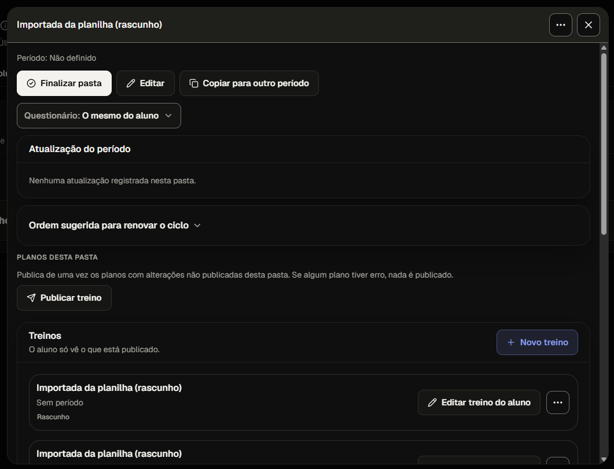 | 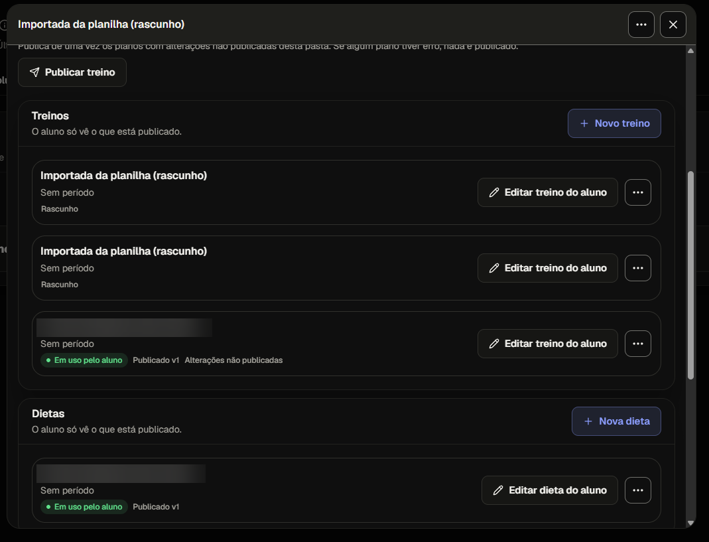 |
| 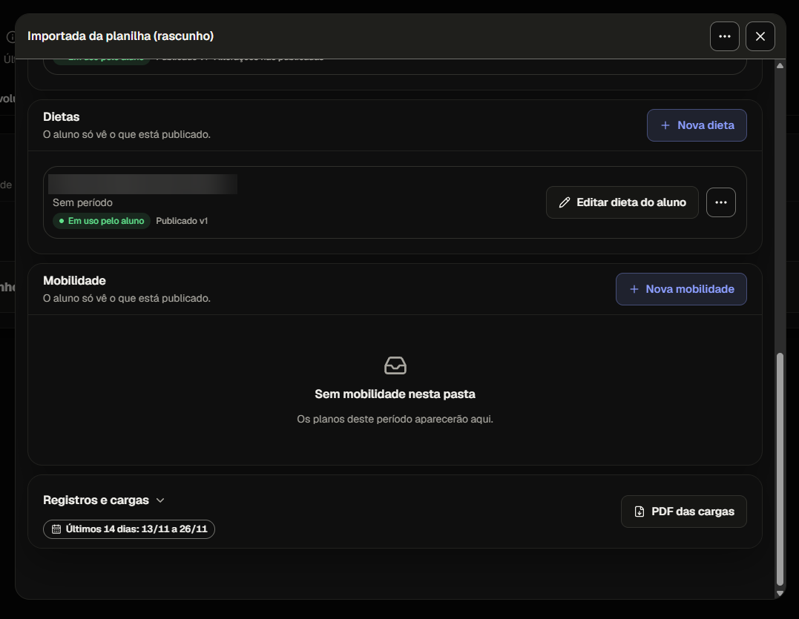 | 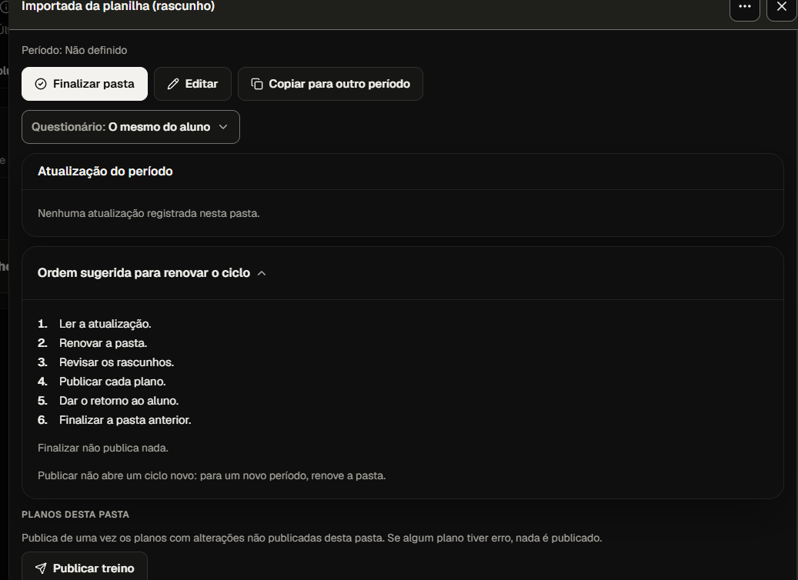 |

**Análise** (a folha é montada em `app/src/treinador/CartaoPastas.tsx`, com `AtualizacaoDaPasta`, `PublicarTudoDaPasta` e
`usePlanosDaPasta`):
- Muitos blocos empilhados com o mesmo peso: ações soltas no topo, seletor de questionário, atualização, "Ordem sugerida",
  o botão "Publicar treino" sozinho acima das listas, três cartões de plano e registros. Não há um ponto de partida claro.
- O "Publicar treino" fica longe dos planos que ele publica e não diz quantos estão pendentes.
- Rascunhos repetidos ("Importada da planilha (rascunho)" duas vezes) parecem iguais; só o selo diz qual o aluno usa.
- "Ordem sugerida para renovar o ciclo" é um texto fixo de seis passos que ocupa espaço e não sabe o que já foi feito.
- "Período: Não definido" e "Sem período" em cada plano repetem a mesma informação.

**Recomendação** (passe pelo `plano-front` antes do `executor-front`):
- Cabeçalho da folha: título, período e situação da pasta numa linha; ações secundárias (Editar, Copiar para outro
  período, Finalizar, questionário) no ⋯ ou numa linha compacta; um único botão primário: **"Publicar alterações (N)"**
  (o Publicar tudo), ao lado dos planos, desabilitado com o motivo quando não há nada.
- Planos numa área só, com abas Treino | Dieta | Mobilidade (com a contagem). Cada linha: título, selo único
  ("Em uso pelo aluno", "Rascunho", "Alterações não publicadas", "Agendado para 27/11" do bloco E), "Editar" e ⋯.
  Rascunho que não é o em uso aparece mais discreto e com a data de criação, para diferenciar os repetidos.
- "Ordem sugerida" vira um checklist que sabe o estado (atualização lida? planos publicados? pasta anterior finalizada?)
  ou sai para o ⓘ da folha. Escolha com o Gustavo se houver dúvida.
- Atualização do período em destaque no topo (é o motivo de abrir a pasta), com "Revisar" quando há envio.
- Período mostrado uma vez só.
- Siga as regras de folha, botões e seleção do `AGENTS.md` (um primário por área, `acao` cria, `secundario` altera,
  `perigo` tonal, `LARGURA_EDITOR` na folha).

**Aceite.** e2e da pasta em 390 e 1280, capturas antes e depois.

---

## G. Criação e edição de questionários (atualização, anamnese, inscrição)

O que o Gustavo disse: "Aproveita e dá uma mexida boa, tanto melhorar, atualizar e criar, na Anamnese e Inscrição."

Listas das abas do Planejamento:

| Inscrição | Anamnese | Atualização |
| --- | --- | --- |
| 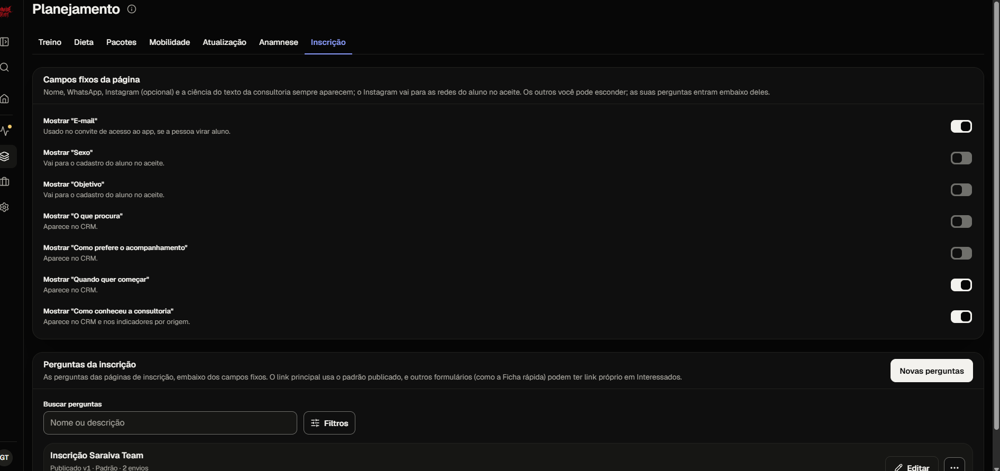 | 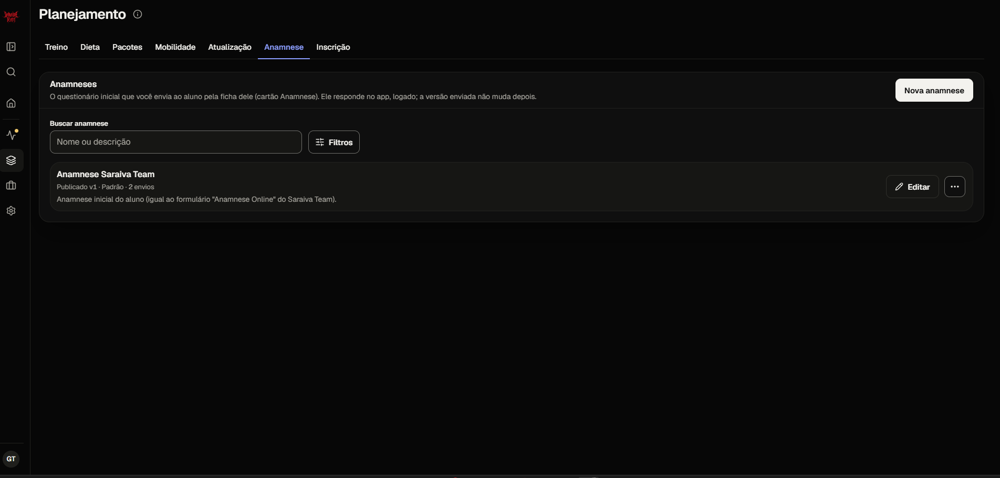 | 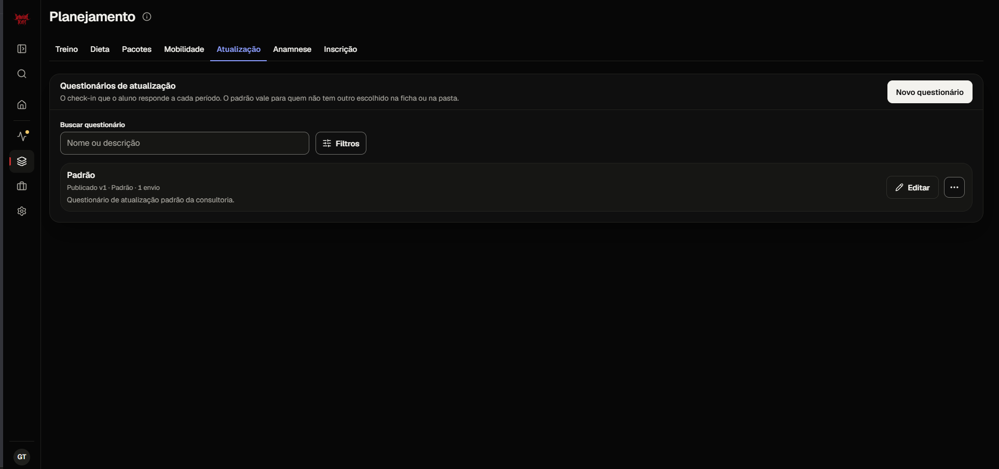 |

Modais de criação (diferentes entre si):

| Inscrição | Anamnese | Atualização |
| --- | --- | --- |
| 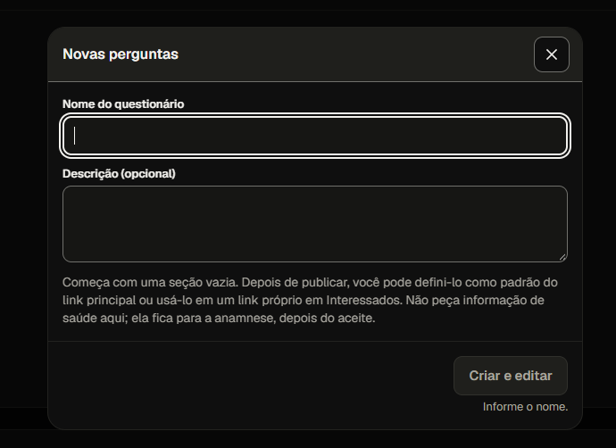 | 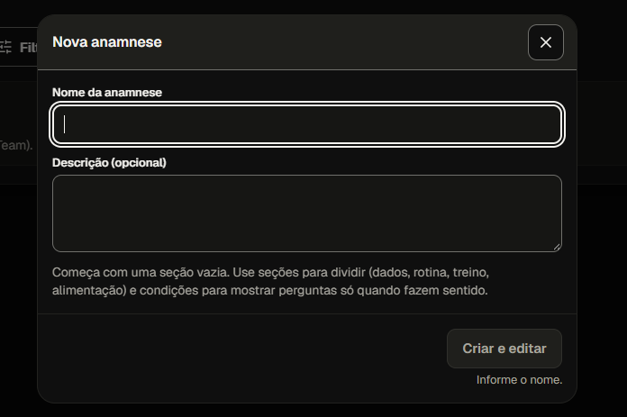 | 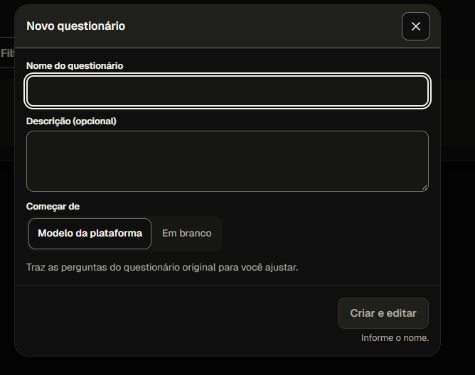 |

Editores:

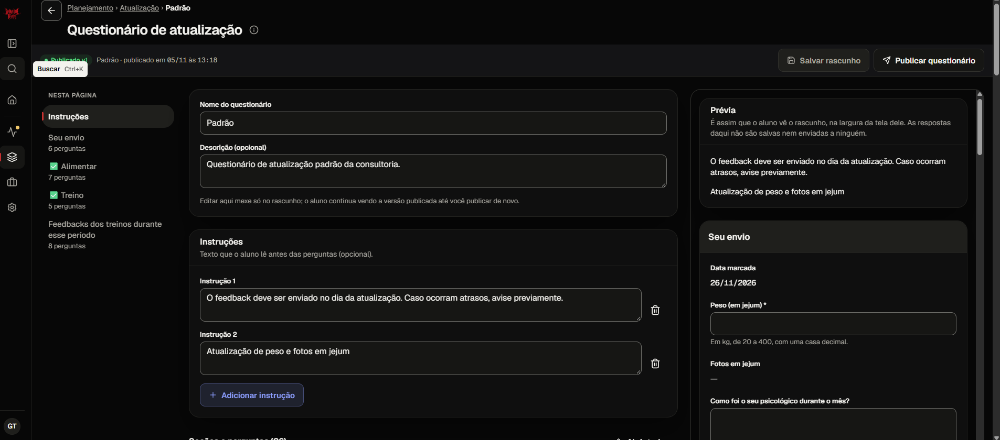
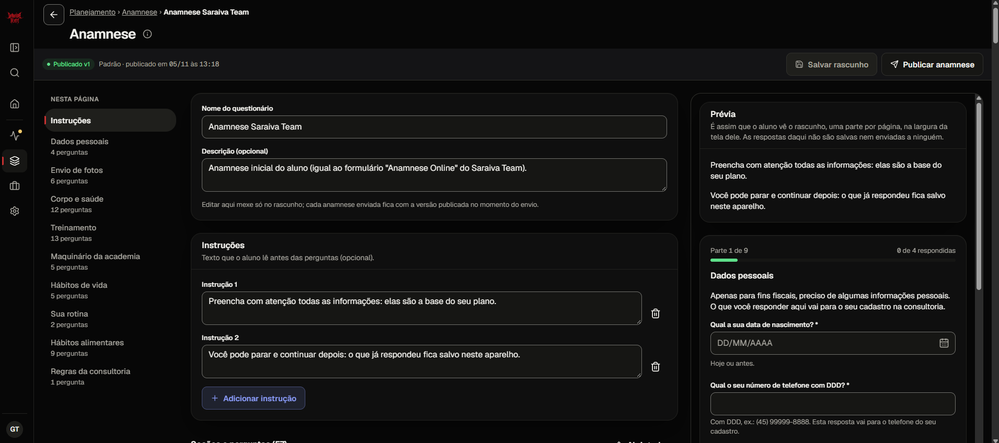
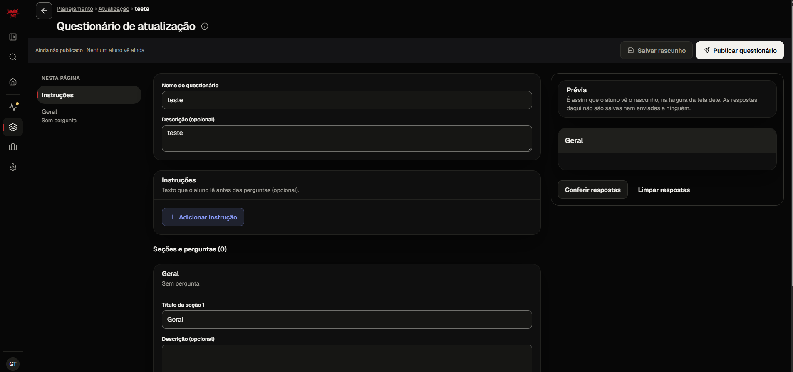
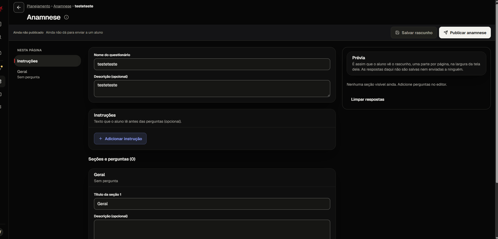
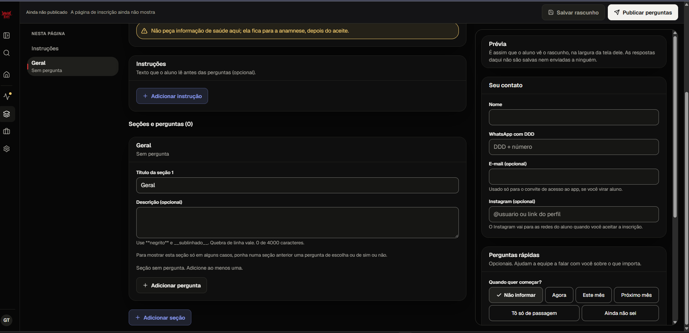

Ações do ⋯:

| | |
| --- | --- |
| 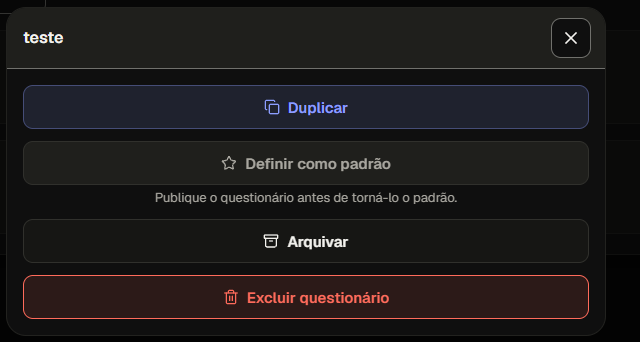 | 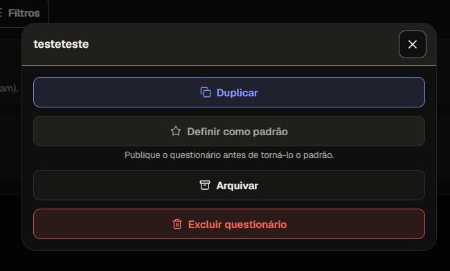 |

**Análise** (código em `app/src/treinador/questionarios/`: `ListaDeQuestionarios`, `EditorQuestionario`,
`IndiceDoQuestionario`, `SecoesDoQuestionario`, `PropriedadesDaPergunta`, `PreviaDoQuestionario`,
`CamposFixosDaInscricao`):
- Os três modais de criação são diferentes sem motivo: só a atualização tem "Começar de"; o da inscrição tem um parágrafo
  longo de regras.
- O editor é um formulário longo: "Instruções" com "Instrução 1/2" em caixas grandes, depois cada seção com título,
  descrição e perguntas abertas uma embaixo da outra. Questionário com 57 perguntas (anamnese do Saraiva) vira uma rolagem
  enorme. O editor vazio abre um formulário de seção "Geral" em vez de convidar a começar.
- O ⋯ abre uma folha com botões grandes de largura inteira (Duplicar colorido, Excluir vermelho gigante), diferente do
  resto do app, que usa a `FolhaDeAcoes` (lista com o item de perigo).
- Na Inscrição, os "Campos fixos da página" ficam na aba, longe das perguntas que aparecem embaixo deles.
- As listas têm um item só e muito espaço vazio.

**Recomendação** (passe pelo `plano-front`; reaproveite padrões que já existem no app):
- **Um só modal de criação** para as três finalidades: Nome, Descrição e "Começar de": Modelo da plataforma (onde existir),
  Copiar de um existente (lista dos da mesma finalidade) ou Em branco. Texto de ajuda de uma linha; a regra de saúde da
  inscrição vira o `Alerta` que já aparece no editor.
- **Editor no padrão lista + inspetor** do editor de treino (`docs/planos/editor-treino-inspetor.md`): à esquerda a lista
  de seções e perguntas (com arrastar para reordenar, `ui/ArrasteDaLista`, e ⋯ com subir/descer para teclado); no meio as
  propriedades da pergunta escolhida; à direita a prévia ao vivo (já existe). No celular, um item aberto por vez.
- **"Adicionar pergunta" como galeria de tipos** (ícone, nome e um exemplo de uma linha), agrupada: Escrever, Escolher,
  Números e notas, Datas e contato, Fotos, Do plano do aluno (o tipo novo do bloco C, só na atualização), Texto e aceite.
- "Instruções" viram um campo de texto do cartão "Sobre" (como o "Sobre o modelo" da mobilidade), sem "Instrução 1/2".
- Editor vazio: estado vazio com "Adicione a primeira pergunta" e a galeria, sem o formulário da seção "Geral".
- ⋯ das listas e do editor: `FolhaDeAcoes` (Duplicar, Definir como padrão com motivo quando desabilitado, Arquivar,
  Excluir como item de perigo com `PainelConfirmacao`).
- Inscrição: os campos fixos aparecem **dentro do editor**, no topo da lista, travados, com o interruptor de esconder ao
  lado de cada um; a aba fica só com a lista.
- Listas das abas: linha com nome, selo de situação (Publicado vN, Rascunho, Arquivado), "Padrão", número de envios e data
  da última edição.

**Aceite.** e2e dos editores (atualização, anamnese, inscrição) e de criação em 390 e 1280; os e2e que já existem
(`inscricao-perguntas`, `anamnese`, editores de questionário) continuam verdes.

---

## Regras que a outra IA não pode esquecer

- Código, comentários, mensagens e commits em **português**. Nada de `alert()`/`confirm()`: confirmação é painel na tela.
- Isolamento por consultoria (`@TenantId`, SQL nativo sempre filtra `consultoria_id`/`aluno_id`), permissão checada no
  servidor, recurso de outra consultoria = 404.
- Peso, dieta, suplementação, dor e fotos são dados sensíveis: nunca em log, auditoria, mensagem de erro, git ou serviço
  externo. Testes e seeds só com dados fictícios.
- Não inventar valor: ausência é "—". O app não opina nem calcula nada sobre saúde (D5).
- Migration nova: um dono por vez, o próximo número livre, subir o total nos dois testes de contagem.
- Verificações: `mvn verify` quando tocar `api/`; `npm run typecheck && npm run lint && npm test` sempre; e2e conforme a
  regra do `AGENTS.md` (contrato de API e peças compartilhadas = suíte inteira).
- Trabalhar na `main`, sem branch nova. **Push só com ordem do Gustavo** (push na `main` publica produção).
- **A árvore de trabalho tem ~70 arquivos alterados de outra frente** (acesso pausado, configurações, conta do aluno) no
  momento em que este documento foi escrito: não faça commit deles, não use `stash` e não os descarte.
- Ao entregar cada bloco: marcar o passo abaixo com o commit e as verificações, e mover o que sobrar para "Pendências
  soltas" no `README.md` desta pasta. Mudança que invalida algo do `AGENTS.md` atualiza o `AGENTS.md` junto.

## Perguntas em aberto para o Gustavo

1. ~~Bloco E: avisar o aluno também na publicação sem data?~~ Respondida em 26/11: sim, "Avisar o aluno" marcado por padrão.
2. ~~Bloco A: "o foco não vai direto" é o teclado cobrindo o campo, o toque no rótulo que não foca, ou os dois?~~ Respondida em 26/11: os dois.
3. ~~Bloco F: "Ordem sugerida" vira checklist com estado real ou sai para o ⓘ?~~ Respondida em 26/11: sai para o ⓘ da folha (feito em `727957c0`).
4. ~~Bloco C: confirmar a lista final de perguntas do questionário do Saraiva antes de gravar em produção.~~ Lista aprovada em
   27/11 ([lote-26-11-textos-e-perguntas.md](lote-26-11-textos-e-perguntas.md)); `--gravar` em produção só com ordem dele.
5. **Aberta (rodada de 28/11, onda 2):** título do cartão da revisão, "Prescrição no envio" ou "Prescrição atual"? O
   cartão passou a mostrar a versão publicada na data da resposta (item 9). Hoje o código usa "Prescrição no envio" com
   envio e "Prescrição atual" sem ele (`dominio/prescritoDaAtualizacao.tituloDoPrescrito`). Decisão do Gustavo.

## Passos

Estado em 27/11/2026, conferido no código da worktree `consultoria-app-rodada-28-11` (branch `rodada-28-11`). O lote de
26/11 está na `main` (base `fb57efa9`); a onda 1 da rodada de 28/11 é o commit **local** `727957c0` (sem push, sem PR); a
onda 2 (itens 9, 10 e 11 do pedido) está aplicada na árvore e **sem commit**. As contagens abaixo são as dos relatórios de
cada onda, não de uma rodada nova.

- [~] A. Teclado no Android/iOS (peça compartilhada) — lote de 26/11 (`Tela`, `Folha`, `RolagemComTopo`, `Campo`; toque no
  rótulo foca o campo). Item 8 da rodada de 28/11: o e2e da atualização em 390 existe e passou na verificação da onda 1
  (`e2e/atualizacao-itens-do-plano.spec.ts`, responde o questionário inteiro em 390 e 1280), mas o e2e da web **não
  reproduz o teclado**: **falta conferir num aparelho** (Android e iPhone). A biblioteca do teclado não foi trocada (a doc do
  Expo sugere `react-native-keyboard-controller`; trocar só com o Gustavo).
- [x] B. Leitura das respostas (aluno e treinador) — lote de 26/11. Item 11 da rodada (vão de 4 px entre pergunta e resposta
  empilhadas, seção 2.1) já valia no código; a onda 2 não precisou mudar nada.
- [x] C1. Tipo `ITENS_DO_PLANO` na API, app, fixtures e editor — API no lote de 26/11; app em `727957c0` (local): campo do
  aluno (`aluno/atualizacao/CampoItensDoPlano.tsx`, regra `dominio/campoItensDoPlano.ts`; Sim/Não abre a lista, motivo por
  item com o rótulo da pergunta, 422 de `DIAS_TREINADOS` no campo sem perder a resposta), controles no editor (o tipo saiu de
  `OCULTOS_NO_MENU`), prévia e leitura (aluno e revisão do treinador); `ItensDoPlanoService` lê a versão liberada da pasta
  (`ItensDoPlanoIntegrationTest`, com plano agendado). Specs: `e2e/atualizacao-itens-do-plano.spec.ts`,
  `e2e/editor-questionario-itens.spec.ts`; jest `campoItensDoPlano.test.ts`.
- [~] C2. Script `atualizacao-saraiva.mjs` — pronto no lote de 26/11, lista aprovada em 27/11, sem `--gravar`. Falta rodar a
  simulação contra a API local (item 2f; ver "Pendências soltas da rodada 28/11").
- [~] D. Revisão do treinador — lote de 26/11 (prescrito ao lado, Evolução, "o que mudou"). Onda 2, **sem commit**: o cartão
  mostra a prescrição da versão publicada na data da resposta (API `atualizacoes/PrescricaoDaEpocaService`, rota no
  `AtualizacaoTreinadorController`, `PrescricaoDaEpocaIntegrationTest`; app `treinador/revisao/usePrescricaoDaEpoca.ts`) e
  o item "Quer trocar" do `ITENS_DO_PLANO` entra no "O que mudou" (`dominio/mudancasDaAtualizacao.ts`). Título do cartão:
  pergunta 5 em aberto. Três colunas na ultralarga: fora da rodada.
- [x] E. Data de liberação + aviso ao aluno — lote de 26/11 (V106). "Cancelar agendamento": fora, por decisão.
- [x] F. Folha da pasta redesenhada — `727957c0` (local): cabeçalho com período uma vez, atualização no topo, planos em abas
  com selo único por linha (`dominio/linhaDoPlano.ts`), "Publicar alterações (N)" e a "Ordem sugerida" no ⓘ. Specs:
  `e2e/folha-da-pasta.spec.ts`, `e2e/pasta-e-atualizacao.spec.ts`.
- [~] G. Criação e edição de questionários — **parcial**, onda 2 **sem commit**: um só "Novo" nas três abas (Nome, Descrição
  e "Começar de": modelo da plataforma só na atualização, "Copiar de um existente", "Em branco"), galeria de tipos agrupada
  (`treinador/questionarios/GaleriaDeTipos.tsx`, `dominio/editorQuestionario.gruposParaAdicionar`), editor vazio com
  "Adicione a primeira pergunta", ⋯ das listas na `FolhaDeAcoes` e linha da lista com "Publicado vN · Padrão · Arquivado"
  e uso. **Ficaram de fora:** editor lista + inspetor com arrastar para reordenar; "Instruções" como campo do cartão
  "Sobre"; campos fixos da inscrição dentro do editor; selo de situação e data da última edição como peças próprias da
  linha.

Verificações relatadas (não refeitas aqui):
- Onda 1 (`727957c0`): `typecheck` limpo, `lint` 0 erros, jest 486 suítes, e2e 1225 passaram, 1 falhou (`filtros-laterais`
  B3), 238 pulados.
- Onda 2 (sem commit): jest 1358 testes, e2e 117 + 26, `ArquiteturaTest` 20, `ItensDoPlanoIntegrationTest` 11,
  `PrescricaoDaEpocaIntegrationTest` 4.
- Item 7 (Histórico, "Ainda não enviados"): spec nova `e2e/historico-nao-enviados.spec.ts` (390 e 1280, escuro e claro;
  sem internet e recusado pelo servidor); resultado no relatório da unidade.

## Fora do escopo

- Cadastro de "máquinas da academia" do aluno (já existe a seção na anamnese).
- Qualquer alerta de "fora do padrão" com limite calculado pelo app (D5).
- Notificação da liberação por e-mail ou WhatsApp (só push e aviso no app, D2).

## Pendências soltas da rodada 28/11

Registradas em 27/11/2026 (origem: auditoria dos pedidos 12, 13 e 15 contra a worktree `rodada-28-11`). Ficam aqui, não no
`README.md`, até a sessão principal integrar.

| Pendência | Origem | Próximo responsável |
| --- | --- | --- |
| Conferência visual das telas do aluno e do PDF no tema Areia e em 1536, 2560 e 3440 px, com capturas (corrigir só o quebrado) | pedido 15, item 12 (e 13d) | sessão principal (rodada de 28/11) |
| Rodar `scripts/questionario/atualizacao-saraiva.mjs` (sem `--gravar`) contra a API local | pedido 15, item 2 (2f) | sessão principal; `--gravar` em produção só com o Gustavo |
| Teclado: conferir num aparelho (Android e iPhone) que o campo tocado fica acima do teclado; biblioteca não trocada | pedido 15, item 8 (13b) | Gustavo, no aparelho |
| `FOLGA_DO_BOTAO` ainda duplicada: `ui/RolagemComTopo.tsx` e `aluno/exercicio/colunasDoExercicio.ts` (`FOLGA_NO_FIM_DA_ROLAGEM`). Importar de `RolagemComTopo` quebra o jest puro de `colunasDoExercicio.test.ts` (o lucide ESM não carrega); proposta: constante num arquivo puro `ui/folgaDoBotao.ts`, importado pelos dois | pedido 15, item 6 | sessão principal (dono dos arquivos novos) |
| Aviso "Seu novo plano" do Início só compara as versões guardadas no aparelho: não anuncia o primeiro plano do aluno | pedido 15, item 3 | Gustavo decide se o primeiro plano também avisa |
| Pergunta `ITENS_DO_PLANO` obrigatória com a lista vazia (sem dieta, sem treino): definir o que o aluno pode responder | pedido 15, item 2 | Gustavo |
| Séries registradas em outro aparelho só entram nos dias treinados ao reabrir o app | pedido 15, item 2 (422 de `DIAS_TREINADOS`) | sessão principal |
| Foto no item da lista (ex.: foto do aparelho, até 2) exige campo na API | pedido 15, item 2 | sessão principal (contrato da API) |
| Rascunho da atualização sem `criadoEm` | onda 1 | sessão principal |
| Bloco G: editor lista + inspetor com arrastar, "Instruções" no cartão "Sobre", campos fixos da inscrição no editor, selo e data de edição como peças | pedido 15, item 10 | próxima rodada |
| Título "Prescrição no envio" × "Prescrição atual" (pergunta 5) | pedido 15, item 9 | Gustavo |
