# Plano de Arquitetura e Produto — Overtraining Pay (Asaas) + Central

**Situação:** Planejamento completo para aprovação (nenhum código iniciado ainda) · **Onde será desenvolvido:** branches separadas (`asaas-overtraining-pay` no `consultoria-app` e `asaas-pagamentos` no repositório unificado `central`) · **Data:** 24/11/2026 · **Base de referência:** `consultoria-app` em `5ae79ef6` (Fase 1 de Contrato Fechado já em produção com a `V098`) e `central` em `7b5ccdf934a3`.

## Estado em 26/11/2026 (vale sobre o resto do documento)

**Decisões do Gustavo (26/11):**
- **Cartão pela página de pagamento do Asaas** (`invoiceUrl`), sem formulário próprio. Nenhum endpoint recebe número, validade nem CVV; o app abre a URL no navegador e confere a situação ao voltar. As menções a "cartão dentro do app", `/cartao`, parcelas e `remoteIp` nas seções abaixo são do desenho de 24/11 e **não valem mais**.
- **Pix continua dentro do app** (QR Code e copia e cola).
- **Asaas é o provedor padrão e a InfinitePay fica de reserva.** Divisão **65% / 35%**, calculada só no servidor, na criação da cobrança, igual para Pix e cartão.
- Rota nova do aluno: `POST /aluno/financeiro/cobrancas/{id}/overtraining-pay/fatura` → `{ url }` (https de `www.asaas.com` ou `sandbox.asaas.com`; 404 para outro aluno ou consultoria; 409 `COBRANCA_NAO_ABERTA`/`PAGAMENTO_EM_CONFIRMACAO`; 503 `OVERTRAINING_PAY_INDISPONIVEL` sem credenciais). A cobrança no Asaas é uma só por `cobranca_aluno` (`billingType` `UNDEFINED`), reaproveitada pelo Pix e pela fatura. Em "Minha conta" o cartão usa o `/minha-conta/cobrancas/{id}/pagar` que já existia.
- Migration: a V101 do Overtraining Pay virou a **V106** em 26/11 e, em 27/11, a **V108** (a V100 antiga da branch saiu, já é a V104 do main; a V105 do main é o contrato digital; a V106 e a V107 ficam para o lote das 3 frentes, liberação de plano e modelos de PDF). **Regra de ordem:** o Overtraining Pay não chega ao main antes do lote das 3 frentes; se a ordem mudar, renumerar a migration para o próximo número livre depois do último do main no momento do merge. A pausa por atraso segue o modelo do main (`acesso_desativado_motivo = 'ATRASO'`); a baixa pelo Asaas reativa só o motivo ATRASO, nunca o MANUAL (teste `baixaPeloAsaasReativaSoOAtrasoENuncaOManual`).

**Pendências do Gustavo:**
- **Conta Asaas com permissão para criar subcontas** (ele está confirmando). Sem ela, nada do Overtraining Pay roda de verdade; os testes usam o `AsaasFalsa`.
- **Validar no sandbox** (não conferido na documentação do Asaas): `GET /payments/{id}/pixQrCode` para cobrança `UNDEFINED`; se o `GET /payments/{id}` devolve o meio real (CREDIT_CARD/PIX) após o pagamento (senão a baixa cai em CONFERIR, falha segura); se a página `UNDEFINED` oferece também boleto.
- **Cartão dentro do app (adiado em 26/11):** ver a decisão e a pendência registradas na seção 8 e em "Pendências soltas" do `docs/planos/README.md`.
- ~~`maxParcelas` e juros da política~~ **removidos em 27/11** do app, da API e da V108 (ver "Rodada antes de ligar" abaixo). O parcelamento é decidido na página do Asaas.

**Revisão independente de 26/11 (`revisor`, sobre o commit `9f6f70d1`) — o que foi corrigido e o que ficou aberto:**
- **Corrigido:** migration renumerada para V106 (depois V108, em 27/11) depois que o main trouxe a V105 do contrato digital (B1); CPF enviado também na fatura quando o aluno não tem cadastro (I1); remover a subconta limpa o `asaas_cobranca_id` das cobranças abertas (I3; coberto só pela inicialização do repositório, sem teste próprio).
- **Aberto, para o Gustavo decidir ou para a próxima frente (nada disso corrompe a baixa: o pior caso cai em CONFERIR):**
  - **`ABATER_MENSALIDADE` não ligar em produção ainda (B2):** o split é calculado uma vez na criação da cobrança, o saldo não é reservado entre cobranças abertas e o abatimento informado à Central é recalculado na liquidação, sem nova tentativa se a Central estiver fora. Corrigir gravando a retenção efetiva na cobrança e notificando esse valor com repetição.
  - Cobrança órfã no Asaas continua pagável (corrida Pix × fatura em duas abas, valor reajustado, renegociação, cancelamento): troca condicional do `asaas_cobranca_id` e remoção no Asaas (confirmar o endpoint) ao sair de ABERTA (I2).
  - Rotação do token do webhook cria outro webhook em vez de trocar o existente; guardar o id e usar `PUT` (I4). Subconta criada no Asaas e não gravada se o webhook falhar: gravar a chave antes (I5).
  - Pagamento por boleto na página `UNDEFINED` cai em CONFERIR `FORMA_DESCONHECIDA` (I6): confirmar no sandbox se a página oferece boleto e decidir entre mapear ou restringir.
  - Carteira da matriz ou do sócio ausente desliga o split sem erro na subida (I7; o mesmo vale na Central, `CENTRAL_ASAAS_SOCIO_WALLET_ID`): decidir se a subida passa a exigir.
  - Menores: exigir `externalReference` igual na consulta; FK composta com `consultoria_id` e índice único parcial em `cobranca_aluno.asaas_cobranca_id` na V108; assinar `PAYMENT_PARTIALLY_REFUNDED` e os eventos de chargeback; `toString` de `GerarPixAsaasRequest`; `temCpfCadastrado` não considera o cliente que já existe no Asaas.

**Decisões do Gustavo (27/11) e rodada "antes de ligar":** implementadas no código em 27/11 (ver o bloco "Rodada antes de ligar: estado" abaixo); **ainda sem commit, sem a bateria final e sem a validação no sandbox**.
- **`ABATER_MENSALIDADE`: não ligar.** Na rodada, bloquear a opção na tela da Central (não selecionável) até existir a retenção gravada na cobrança e o aviso à Central com repetição (B2 acima).
- **Carteira ausente:** com o Asaas configurado (credenciais presentes) e sem a carteira da matriz ou do sócio, a aplicação **não sobe**, com mensagem clara. Vale para o consultoria-app (`TREINOS_PAGAMENTOS_ASAAS_WALLET_MATRIZ` e `_WALLET_SOCIO`) e para a Central (`CENTRAL_ASAAS_SOCIO_WALLET_ID`). Sem Asaas configurado, sobe normal (I7).
- **Boleto:** mapear como forma válida de pagamento, para a baixa não cair em CONFERIR (I6). Confirmar no sandbox como ele aparece em `GET /payments/{id}`.
- **Parcelas e juros:** remover `overtrainingPayMaxParcelas`, `overtrainingPayJuros` e o texto "Cartão em até Nx" da tela e do contrato. Se o sandbox mostrar um parâmetro do Asaas que limite o parcelamento na página, registrar como pendência.
- **Link antigo e cobrança órfã:** ao mudar o valor, reajustar, renegociar, cancelar ou na corrida Pix × fatura, cancelar no Asaas a cobrança anterior (I2). **Bloqueia ligar.**
- **Pix da Central sem reserva nem prazo:** decidido em 27/11, **A + B**: cancelar no Asaas o QR pendente quando o restante muda (o mesmo mecanismo da cobrança órfã) e prazo curto no QR; a opção C está descartada. Opções e impacto em `asaas-pagamentos.md` (repositório da Central). Entra em "bloqueia ligar" da Central.

**Bloqueia ligar em produção** (estado em 27/11, código feito, falta bateria e sandbox):
1. [x] `ABATER_MENSALIDADE` bloqueado: na Central (tela e 409 no back) e, aqui, o cálculo do split trata o modo como sem retenção. A retenção gravada com aviso repetido segue como trabalho futuro.
2. [x] Carteira ausente derruba a subida (consultoria-app: `AsaasProperties.exigirCompleta`; Central: `AsaasPropriedades`).
3. [x] Boleto mapeado como forma válida (`ProvedorAsaas.mapearForma`); falta conferir o `billingType` real no sandbox.
4. [x] Parcelas e juros removidos da tela, do contrato, da entidade e da V108.
5. [x] Cobrança anterior cancelada no Asaas nas cinco situações (fila `cancelamento_asaas_pendente` + worker). **Não validado no sandbox.**
6. [ ] Tarefa do Gustavo (no roteiro): assinar no painel do Asaas `PAYMENT_PARTIALLY_REFUNDED` e os eventos de chargeback na Central. Na consultoria o webhook de cada subconta é criado pela API e já inclui os quatro eventos novos.
7. [x] Índice único parcial por consultoria em `cobranca_aluno (consultoria_id, asaas_cobranca_id)` e FKs compostas (V108).
8. [ ] Validações no sandbox: `pixQrCode` com `UNDEFINED`, o meio real em `GET /payments/{id}`, o boleto na página e, **condição para ligar o cancelamento**, se o `DELETE /payments/{id}` recusa cobrança `RECEIVED`/`CONFIRMED`.

### Rodada antes de ligar: estado (27/11/2026, base `613049d6` + alterações locais sem commit)
**Feito, com teste focado verde (agente da API, `mvn -o -Dtest=...`, 13 classes):** carteira ausente; boleto; parcelas e juros removidos (resposta e corpo de `GET/PUT /financeiro/overtraining-pay`: saíram `maxParcelas` e `jurosParcelamento`; `GET /aluno/financeiro`: saíram `overtrainingPayMaxParcelas` e `overtrainingPayJuros`; colunas `max_parcelas`, `juros_parcelamento` e seus CHECK saíram direto da V108, sem migration nova; o app não tem mais nenhum desses nomes, só asserções negativas em `overtrainingPay.test.ts`); cancelamento da cobrança anterior (ouvinte `@PostUpdate` em `CobrancaAluno` grava a órfã em `cancelamento_asaas_pendente` na mesma transação; `CancelamentoDeCobrancaAsaas` apaga no Asaas fora de transação, roda dentro do `ConciliadorAsaas`; 2xx/404 apaga a linha, outro 4xx marca `FALHOU`, 5xx/rede reagenda até 12 vezes; troca do id com compare-and-set no checkout, quem perde a corrida apaga a cobrança que criou); estorno parcial e chargeback viram CONFERIR `ESTORNO_INFORMADO` (eventos também no webhook da subconta); V108 com `UNIQUE (consultoria_id, id)`, FKs compostas em `cliente_asaas_aluno`, índice único parcial por consultoria (não global, para os `pay_fake_N` de teste não colidirem; no Asaas real o id já é único) e a tabela da fila; teste da limpeza do `asaas_cobranca_id` ao remover a subconta; `ABATER_MENSALIDADE` no `CalculadorDeSplitAsaas` devolve `SEM_SPLIT` (nada retido, nada abatido; o fluxo principal do teste passou a usar `TAXA_PLATAFORMA` 10%, split esperado 13,00/7,00). Total de migrations segue 105 (a V108 já estava contada).

**Para decidir / pendências desta rodada (nenhuma corrompe a baixa; o pior caso é CONFERIR):**
- **Cancelamento no consultoria-app sem chave própria.** Na Central o cancelamento ganhou `CENTRAL_ASAAS_CANCELAMENTO_ENABLED` (padrão `false`) porque o `DELETE` pode aceitar cobrança paga. Aqui o worker roda sempre que a conciliação está ativa; um 4xx do Asaas (cobrança já paga) vira `FALHOU` sem nova tentativa, mas isso assume que o Asaas recusa. **Decisão do Gustavo: dar a mesma chave (padrão desligado) ou aceitar a suposição até o sandbox.**
- A fila só esvazia a cada ~10 s: janela curta em que a órfã segue pagável (se paga, cai em CONFERIR). Com `conciliacao-ativa=false` o worker não roda sozinho.
- Cobrança órfã de subconta removida: o Asaas não é avisado, a linha da fila vai para `FALHOU` (sem chave), as abertas ficam pagáveis lá e o webhook morre com a subconta; um pagamento ali nem chega ao CONFERIR.
- Linhas `FALHOU` da fila não têm limpeza nem tela.
- O `@PostUpdate` que faz INSERT por JDBC dentro do flush do Hibernate funcionou em todos os testes, mas pede **revisão independente** (pagamentos + migration) antes de ligar.
- Interpretação do item `ABATER_MENSALIDADE`: sem taxa fixa no código, "nada retido" foi a leitura segura (reter percentual sem abater cobraria o treinador sem desconto). Mudar é uma linha.
- Não validado no sandbox: `DELETE /payments/{id}`, `billingType=BOLETO`, estorno parcial manter `RECEIVED`, nomes dos eventos novos. `CapacidadesDoProvedor.maxParcelas` (12) segue como capacidade interna do provedor; `boleto` segue `false` lá.

**Textos de tela e guia desta rodada (todos aprovados pelo Gustavo em 27/11; PDFs do guia regenerados uma vez, depois que os dois agentes terminaram):**
- Central: opção "Abater mensalidade (Ainda não disponível)"; ajuda "Ainda não disponível. Esta contratação já usa este modo; para mudar, escolha outro."; homologação "Pix no app e cartão na página de pagamento do Asaas. O valor é dividido automaticamente entre as carteiras dos sócios."
- App: checkout do aluno "Com cartão, você paga na página segura do Asaas, no navegador. O app não recebe nem guarda os dados do cartão."; prévia "No aplicativo: Pix na hora, pelo QR Code, e cartão pela página do Asaas."; títulos de seção "Pix na hora" (aluno e fatura na Central); `FolhaPagamentoCentralAsaas` "Gere o Pix na hora, pelo QR Code, para quitar sua fatura sem sair do aplicativo."; `CartaoFormasDeRecebimento` "O aluno paga com Pix na hora, pelo QR Code, no aplicativo, ou com cartão na página de pagamento, com baixa automática."
- Guia (`app/src/ajuda/conteudo.ts`): "Overtraining Pay (receber no aplicativo)", "Homologação e conta de repasse", "Como pagar", "Pagar no próprio aplicativo (Overtraining Pay)" e "Assinatura e faturas (Minha conta)".
- Vocabulário: "Em breve" não se usa em texto de tela; "Pix na hora, pelo QR Code" no lugar de "QR Code Pix imediato". Botões e rótulos de acessibilidade ("Gerar QR Code Pix", "QR Code Pix da fatura", "QR Code Pix para pagamento") ficam como estão. Prancha e docs mantêm "Pix imediato" como nome do quadro.

**Fila de verificação (a máquina é compartilhada; só roda depois do "pode rodar a bateria" do Gustavo):** Central (`mvn clean verify`, Karma, e2e:tipos, Playwright, verificar-docs back/front, verificar-contrato-api); consultoria-app (`mvn verify` completo no fim, typecheck, lint, Jest, e2e); depois a rodada no sandbox (arquivo da chave do Gustavo) e os commits locais. Sem push.
9. Teste próprio da limpeza do `asaas_cobranca_id` ao remover a subconta.

**Pode esperar (também em "Pendências soltas" do `docs/planos/README.md`):** rotação do token do webhook (I4), subconta órfã (I5), `toString` de `GerarPixAsaasRequest`, `temCpfCadastrado`, o texto "Pix e Cartão" em `central-api-front/.../homologacao-split.component.ts:74` e os itens 3 e 6 da revisão da Central.

**Verificação de nível completo (27/11/2026, sem push; origin/main `cb8c6fec` contido na branch):**
- `mvn verify` (`api/`): 3565 testes, 1 falha = `ImportacaoIntegrationTest.previaNaoGravaECsvEXlsxCriamAluno`, intermitência do próprio teste já existente no `main` (409 `PREVIA_DESATUALIZADA`; `.xlsx` montado duas vezes; ver "Pendências soltas" do `docs/planos/README.md`); isolado passa na branch e no `origin/main` (41 testes). Tempo: 1h45.
- `npm run typecheck` ok (55 s antes do merge, 181 s depois), `npm run lint` ok (0 erros, 10 avisos antigos; 39 s e 90 s), Jest 463 suítes e 11248 testes ok (58 s antes, 208 s depois do merge do main).
- e2e completo (`npx playwright test`, 8 workers): 3372 passaram, 299 pulados, 10 falhas em 32m56. 8 reais da branch (as telas de Recebimento do `financeiro.spec.ts` não abriam "Integrações externas opcionais"), corrigidas e passando (commit `f74fa417`); 2 intermitentes (`arrastar.spec.ts:352` e `tela-larga-app-do-aluno.spec.ts:133`), passam isoladas. Não rodei o e2e inteiro de novo depois do merge do main (só mexeu em `CampoDaTabela`, `TotalDoDia`, `Campo` e `PreferenciasDoApp`).
- Renumeração V108 (nível rápido): `FlywayMigrationIntegrationTest` e `PapeisBancoIntegrationTest` (total 105) mais as 8 suítes do Overtraining Pay, Asaas e split, todas verdes.

**Não conferido ou atenção:**
- **Pasta de trabalho separada (worktree) precisa de `npm ci` próprio em `app/`.** Com `node_modules` sendo um atalho (junction) para a pasta principal, o `expo export` sai sem rotas (bundle de ~1,2 MB, tela em branco, "No routes found") e o e2e falha em massa por tela vazia, sem relação com o código da branch (visto em 27/11 neste worktree: 383 falhas; depois do `npm ci` o spec `abas-alcance` passou). Remover a pasta no futuro: o `node_modules` dela agora é próprio, não há atalho a desfazer. O Gustavo leva isso ao `AGENTS.md` pela sessão dos níveis de validação.
- Não verificado no sandbox do Asaas (depende da conta): `pixQrCode` com cobrança `UNDEFINED`, meio real em `GET /payments/{id}` e boleto na página.

---

> **Regra de ouro deste plano:** nada do que já roda em produção para o piloto do Saraiva é removido ou quebrado. Todo o trabalho acontecerá em **branches isoladas** nos dois repositórios, com servidor simulado (`AsaasFalso`) para rodar 100% dos testes locais mesmo **antes** de abrir a conta PJ no Asaas.

---

## 1. Visão Geral: As Duas Camadas de Dinheiro e o Papel de Cada Provedor

O ecossistema passa a ter o **Asaas (API v3)** como **motor principal de Checkout Transparente, Conta de Repasse e Split** nas duas pontas, preservando a **InfinitePay** e a **Kiwify** como opções secundárias prontas para quem quiser usá-las:

| Camada | Repositório | Provedor Principal (Padrão) | Provedores Secundários (Mantidos 100%) | O que sai / muda |
| --- | --- | --- | --- | --- |
| **1. Treinador cobra seus Alunos** | `consultoria-app` | **Overtraining Pay (Asaas v3)** — Checkout Transparente dentro do app (QR Code Pix + Copia e Cola + Cartão até 12x + Recorrência), Subconta White-Label com Conta Bancária de Repasse e Split na fonte | • **InfinitePay** (link externo por cobrança + webhook + `payment_check`) • **Kiwify** (só assinatura mensal externa) • **Pix estático EMV**, **Link próprio** e **Manual** | **Mercado Pago não entra** no `consultoria-app`. O aluno para de ser jogado para fora do app quando o treinador usa o Overtraining Pay. |
| **2. Você + Saraiva cobram o Treinador** | `central` *(repositório unificado no GitHub)* | **Asaas v3** — Checkout Transparente em `Minha conta`, Boleto/Pix, Cartão recorrente e **Split imediato entre sócios (65% Gustavo / 35% Saraiva)** | • **InfinitePay** (mantida 100% funcional como contingência por link externo) | **Mercado Pago deixa de ser o padrão** da Central (`CENTRAL_PAGAMENTO_PROVEDOR=ASAAS`). Nunca teve credenciais na VPS nem recebeu pagamentos. |

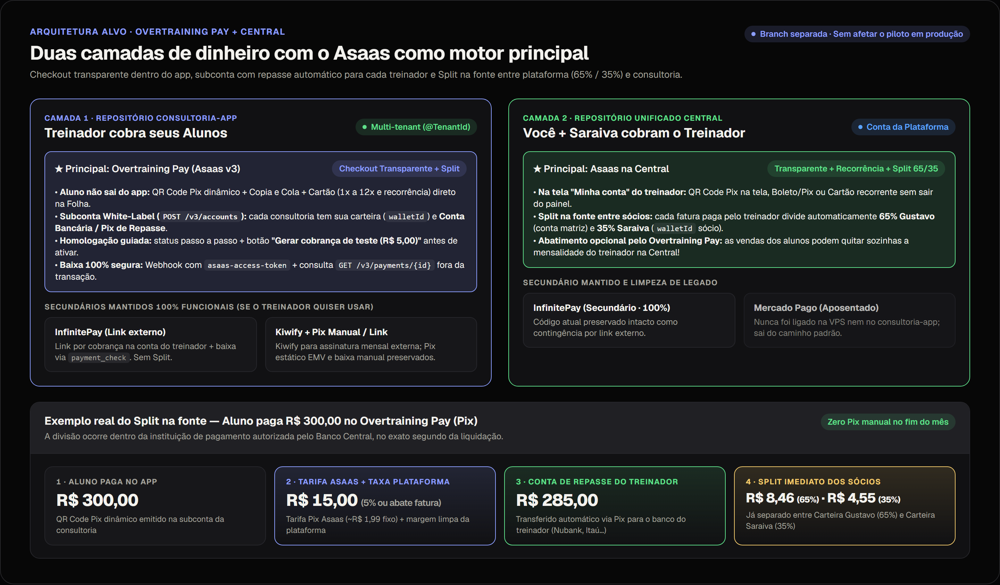

### Como funciona o fluxo financeiro (Split + Repasse) na prática

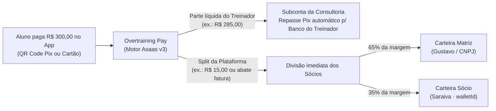

---

## 2. Diagnóstico Visual ("De → Para"): Do Link Externo e dos Prints de Homologação ao Overtraining Pay

### 2.1. Como é hoje no `consultoria-app` (InfinitePay por link externo)
Hoje a tela de recebimento pede apenas a `InfiniteTag` e uma `API Key` opcional, e o aluno sai do aplicativo para concluir o pagamento numa aba externa da InfinitePay (sem Split e sem conta bancária de repasse dentro do sistema):

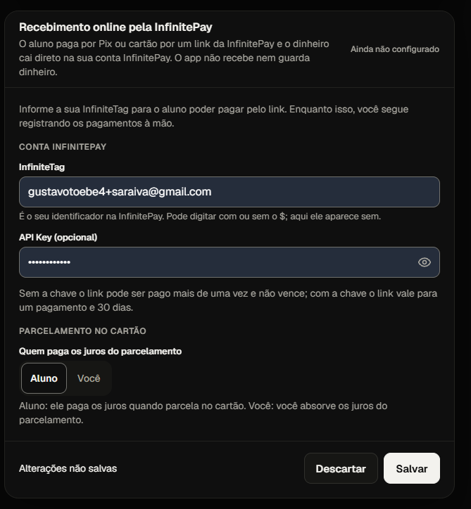

### 2.2. O que aproveitamos dos seus prints de referência (Homologação Bancária / CondoConta)
Analisando os prints enviados como referência de homologação bancária e conta de repasse, trouxemos os **4 melhores conceitos operacionais** para a linguagem visual limpa do Overtraining — e eliminamos toda a burocracia bancária antiga de boleto de condomínio (CNAB 240/400, carteira, nosso número, espécie DM e protesto):

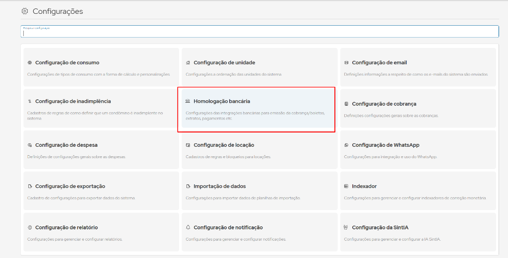

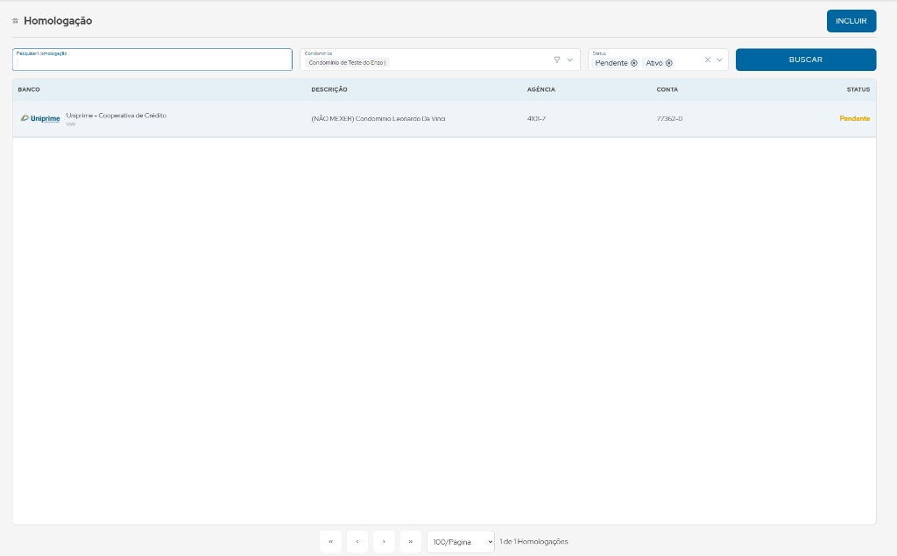

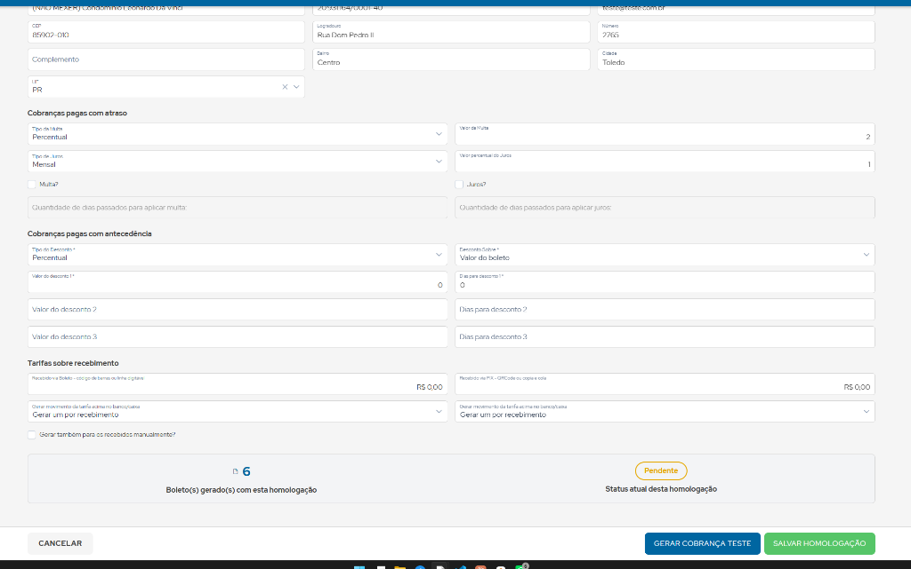

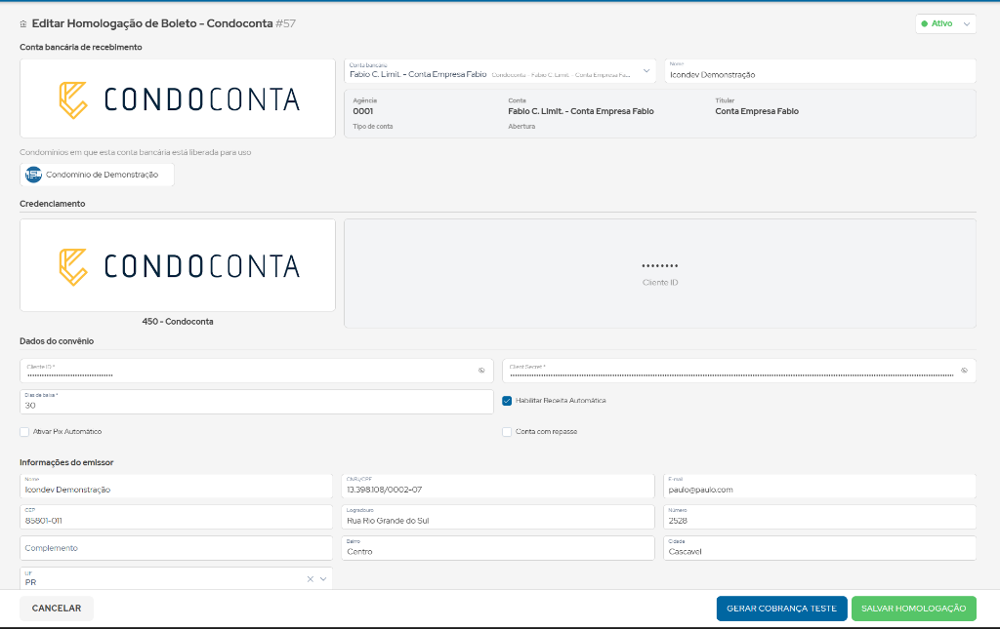

| Conceito vindo dos prints de referência | Como entra no Overtraining Pay (Asaas) |
| --- | --- |
| **Atalho em Configurações + Aba Recebimento** | Cartão **"Homologação e Conta de Repasse"** no Hub `/treinador/configuracoes` abrindo direto `Financeiro › Recebimento`. |
| **Conta bancária de repasse + Dados do emissor** | O treinador cadastra CPF/CNPJ, endereço, contato e a **conta bancária dele** (qualquer banco: Nubank, Itaú, Inter, Sicredi…) para receber o repasse automático diário via Pix. |
| **Contador + Selo `Pendente` / `Ativo`** | Faixa de homologação mostrando quantas cobranças já foram liquidadas na conta e o estado exato: `Não configurado` → `Documentos pendentes` → `Pronto para teste` → `Ativo e homologado`. |
| **Botão `Gerar cobrança de teste` ao lado do `Salvar`** | Antes de abrir o checkout para os alunos, o treinador clica em **`Gerar cobrança de teste`** (R$ 5,00, valor mínimo da API do Asaas), paga o QR Code Pix e vê na tela o webhook + repasse confirmarem tudo ao vivo! |
| **O que cortamos de propósito** | Nada de CNAB, arquivo remessa/retorno, código cedente, carteira `009`, espécie `DM` ou lote bancário: a API REST v3 do Asaas faz tudo em tempo real por JSON e webhook. |

---

## 3. Maquetes das Novas Telas (`consultoria-app` e `Central`)

### 3.1. `consultoria-app` · Aba Recebimento e Homologação Bancária do Overtraining Pay (Tema Escuro)
Na coluna esquerda ficam:
1. **Formas de recebimento** com o **Overtraining Pay** em destaque no topo (`Principal · No app`) e a **InfinitePay** logo abaixo como opção secundária (`Secundário · Link externo`).
2. **Homologação bancária · Overtraining Pay** com a trilha de 4 passos (`1. Titular` → `2. Conta de repasse` → `3. Documentos` → `4. Cobrança teste`), os campos limpos do banco de repasse e do emissor, o contador de cobranças liquidadas e os botões **`Gerar cobrança de teste`** e **`Salvar homologação`**.
3. **Integrações externas opcionais (InfinitePay e Kiwify)** recolhidas num acordeão discreto logo abaixo.
4. Na coluna direita permanece o cartão **"O que o aluno vê"**, atualizado em tempo real.

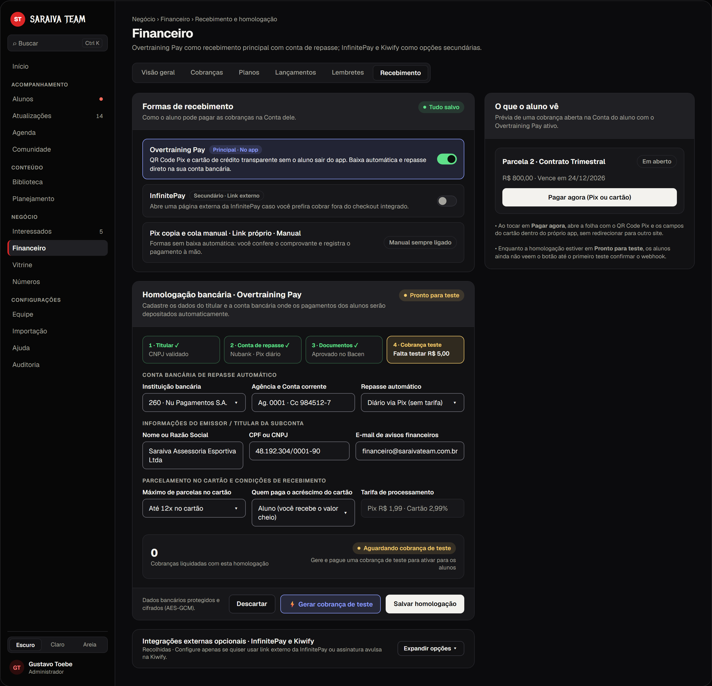

---

### 3.2. `consultoria-app` · Folha "Cobrança de teste da homologação" e Conta Ativa (Tema Claro)
Ao clicar em **`Gerar cobrança de teste`**, abre uma `Folha` dedicada com um QR Code Pix de **R$ 5,00** (piso mínimo exigido pelo Asaas). Assim que o treinador paga:
- O webhook `/api/publico/pagamentos/asaas/{tokenCaminho}` recebe o aviso;
- O `ConciliadorAsaas` confere em `GET /v3/payments/{id}` fora da transação;
- Os 4 itens da lista ficam verdes ao vivo e a conta passa automaticamente para **`Ativo e homologado`**, liberando o Checkout Transparente para os alunos da consultoria!

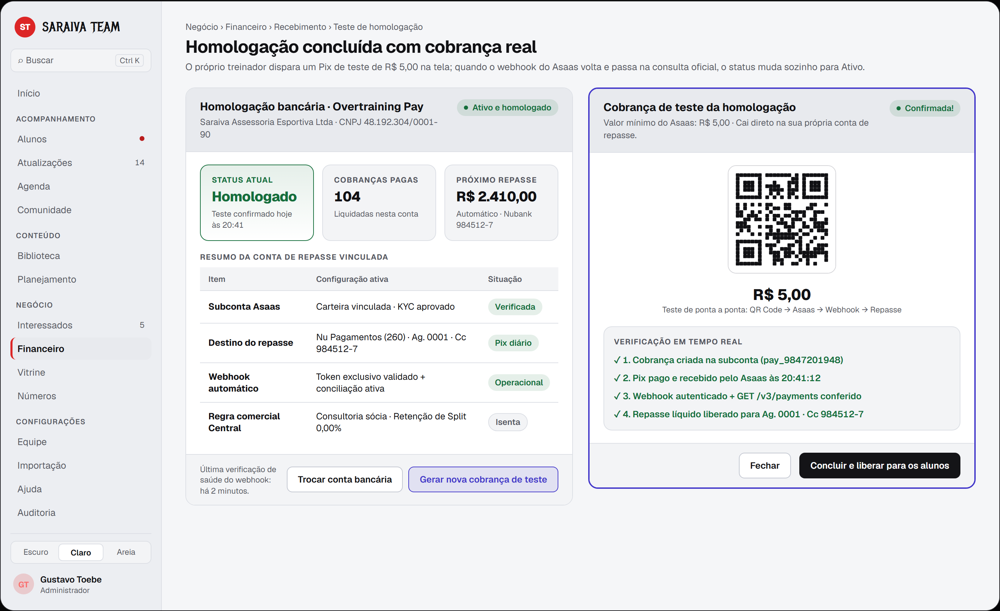

---

### 3.3. `consultoria-app` · Checkout Transparente do Aluno no Celular e Encaixe com Fases 1 e 2
Veja como o Overtraining Pay conversa diretamente com o que acabou de subir para produção na **Fase 1 (Contrato fechado, `V098`)** e com a **Fase 2 planejada (Pausar acesso por atraso)**:
- **Quadro 1 (`Conta › Meu plano`)**: a aluna Mariana Costa vê o Contrato Trimestral (`R$ 3.000,00`) e a `Parcela 2 de 3` marcada como **`Vencida`** (`R$ 800,00`), com o botão **`Pagar agora · R$ 800,00`**.
- **Quadro 2 (`Folha · Pix imediato`)**: sem sair do app e sem abrir navegador, o QR Code dinâmico e o botão **`Copiar código Pix copia e cola`** abrem numa `Folha`. Enquanto a folha está aberta, o app faz polling leve da situação da cobrança (a cada 4 s) e mostra *"Pagamento confirmado!"* assim que o webhook dá baixa.
- **Quadro 3 (`Folha · Cartão de crédito` + Fase 2)**: o aluno digita o cartão e escolhe de `1x` até `maxParcelas` (com os juros absorvidos pelo treinador ou repassados ao aluno conforme configurado). Se o aluno estava com o **acesso pausado por atraso (Fase 2)**, a baixa pelo provedor reativa o acesso dele na mesma transação!

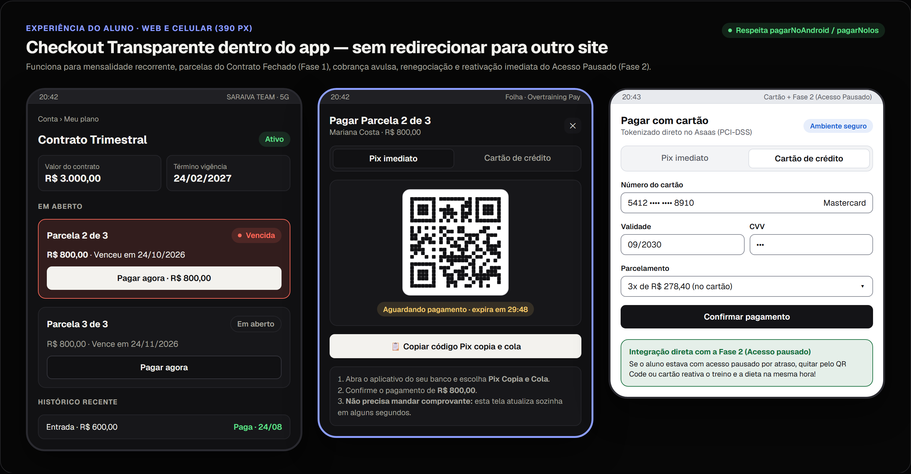

---

### 3.4. `Central` · Homologação Asaas Principal, InfinitePay Reserva e Split 65% / 35% dos Sócios
No painel do operador da **Central** (repositório unificado `central`):
- **Asaas** fica configurado como provedor principal e **InfinitePay** permanece pronta como contingência.
- O operador cadastra a carteira Asaas do sócio (`CENTRAL_ASAAS_SOCIO_WALLET_ID`) com **35,00%**, mantendo **65,00%** automaticamente na conta emissora principal do CNPJ (regra oficial do Asaas: a conta emissora não vai no array `split` e retém o saldo líquido restante).
- Na contratação de cada consultoria na Central, o operador escolhe o **Modo de Split do Overtraining Pay** daquela consultoria:
  1. **`ISENTO`** (ex.: **Saraiva Team** — `0%` de retenção; 100% líquido vai para a conta do Saraiva);
  2. **`ABATER_MENSALIDADE`** (ex.: retém `10%` de cada cobrança paga pelos alunos daquela consultoria até quitar a fatura mensal de R$ 189,90 na Central; bateu R$ 189,90 no mês, as próximas cobranças dos alunos daquele mês saem com `0%` de retenção para a plataforma!);
  3. **`TAXA_PLATAFORMA`** (ex.: retém `2,0%` fixos por cobrança liquidada no Overtraining Pay, já divididos 65% / 35% entre as carteiras dos sócios).

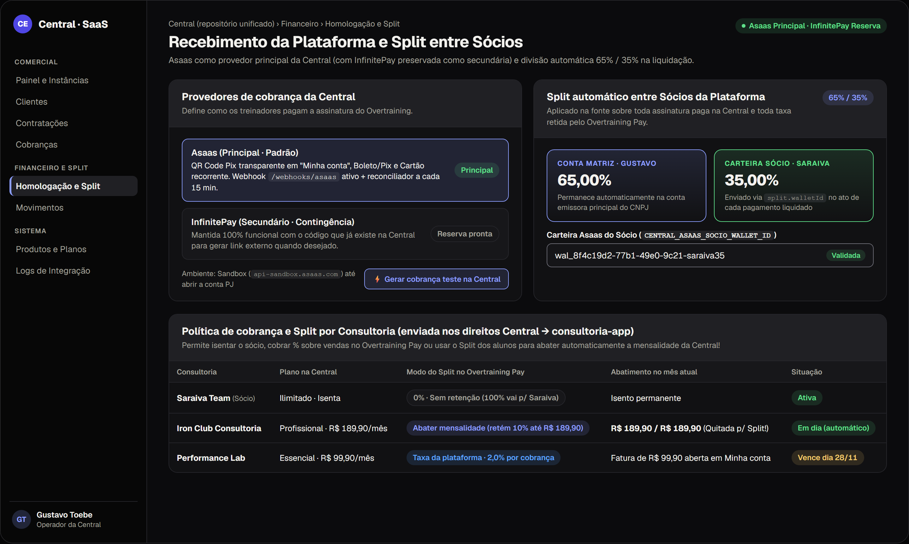

---

### 3.5. `consultoria-app` · Tela `Configurações › Minha conta` do Treinador (Pagando a Central)
Para fechar as duas pontas, a tela **`Minha conta`** (onde o treinador vê o plano dele com o Overtraining via `FonteDaContaCentral`) ganha:
- O acompanhamento transparente do **abatimento automático pelo Split** quando a consultoria estiver nesse regime;
- O **Checkout Transparente Asaas** direto na tela para quitar eventual saldo ou fatura mensal por **QR Code Pix** ou **Cartão recorrente**, mantendo um botão discreto de contingência para o link da **InfinitePay** quando a Central estiver operando no provedor secundário.

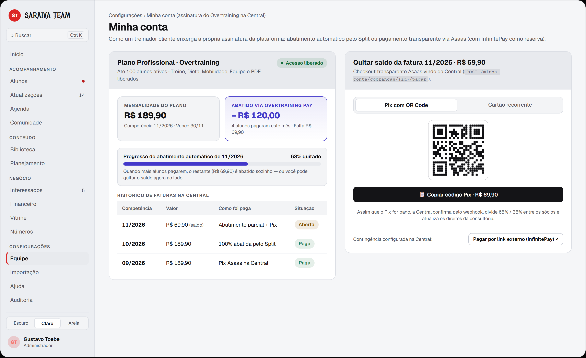

---

## 4. Como Desenvolver Tudo Agora Sem Ter Conta no Asaas Ainda

Ainda não ter a conta PJ aberta no Asaas **não trava nada** nem no backend nem no frontend:

1. **Estágio 1 — Desenvolvimento e Suíte Completa Local (`AsaasFalso`, zero conta externa)**:
   - Seguindo a convenção de `AGENTS.md` e `pagamentos-infinitepay.md`, criamos um servidor HTTP local nos testes (`AsaasFalso`, levantado com `HttpServer` do próprio JDK) que simula fielmente os endpoints da API v3 do Asaas (`POST /v3/accounts`, `GET /v3/myAccount/status`, `POST /v3/customers`, `POST /v3/payments`, `GET /v3/payments/{id}/pixQrCode`, `POST /v3/creditCard/tokenizeCreditCard`, `GET /v3/payments/{id}` e disparo de webhooks com header `asaas-access-token`).
   - No `app/`, o `e2e/api-falsa.ts` e o modo local simulam todos os estados da homologação (`NAO_CONFIGURADA`, `DOCUMENTOS_PENDENTES`, `PRONTA_PARA_TESTE`, `ATIVA`) e o Checkout Transparente de Pix e Cartão.
   - Com `TREINOS_PAGAMENTOS_ASAAS_HABILITADO=false` (padrão até virar a chave), o código pode inclusive conviver desligado sem exigir variáveis na VPS.
2. **Estágio 2 — Homologação Gratuita em Sandbox (`https://api-sandbox.asaas.com/v3`)**:
   - O Asaas possui ambiente oficial de **Sandbox** separado de produção, onde é possível criar subcontas fictícias, gerar QR Codes Pix de teste, aprovar pagamentos simulados pelo painel/API do Sandbox e validar o recebimento real dos webhooks passando pelo Caddy/Cloudflare.
3. **Estágio 3 — Virada para Produção (`https://api.asaas.com/v3`)**:
   - Quando o CNPJ e a conta matriz Asaas estiverem aprovados, basta gravar as variáveis em `/opt/ecossistema/central.env` e `/opt/ecossistema/consultoria.env` pelo `gravar-segredo.sh`, apontar a URL para `https://api.asaas.com/v3` e clicar em **"Gerar cobrança de teste (R$ 5,00)"** na própria tela!

---

## 5. Especificação Técnica Detalhada

### 5.1. Endpoints Oficiais da API v3 do Asaas Utilizados

| Operação | Método e Rota no Asaas v3 | Qual chave autentica (`access_token`) | Observações importantes |
| --- | --- | --- | --- |
| Criar subconta da consultoria | `POST /v3/accounts` | Chave da **Conta Matriz** (Plataforma) | Devolve `id`, `walletId` (para Split), `apiKey` exclusiva da subconta (guardada cifrada em AES-GCM) e dados de onboarding. Exige `cpfCnpj`, `name`, `email`, `mobilePhone`, `incomeValue` (renda/faturamento), `address`, `postalCode` e `birthDate` (quando PF) ou `companyType` (quando PJ). |
| Consultar aprovação / KYC da subconta | `GET /v3/myAccount/status` e `GET /v3/myAccount/documents` | `apiKey` da **Subconta** | Aguardar >= 15 s após criar a subconta para ler documentos pendentes e capturar `onboardingUrl` (link seguro do Asaas para selfie/documento do titular). |
| Configurar webhook automático da subconta | `POST /v3/webhooks` | `apiKey` da **Subconta** (ou Matriz) | Cadastra a URL `https://overtraining.app/api/publico/pagamentos/asaas/{tokenCaminho}` com `authToken` aleatório de 32 bytes (enviado pelo Asaas no header `asaas-access-token`). |
| Cadastrar/atualizar pagador (aluno) | `POST /v3/customers` | `apiKey` da **Subconta** | Vincula `externalReference = aluno.id`. Necessário no Asaas para emitir Pix dinâmico ou cartão (pede nome e CPF/CNPJ do aluno ou do `responsavel_financeiro` quando houver!). |
| Criar cobrança Pix ou Cartão com Split | `POST /v3/payments` | `apiKey` da **Subconta** | `billingType`: `PIX` ou `CREDIT_CARD`; `externalReference = cobranca.id`; array `split` com as carteiras da Plataforma (65% / 35%) quando houver taxa/abatimento. **Regra do Asaas:** nunca incluir o `walletId` da própria conta emissora no array `split`. Valor mínimo no Asaas: **R$ 5,00**. |
| Ler QR Code e Copia e Cola do Pix | `GET /v3/payments/{id}/pixQrCode` | `apiKey` da **Subconta** | Devolve `encodedImage` (PNG em Base64) + `payload` (BR Code dinâmico) + `expirationDate`. |
| Tokenizar / cobrar cartão transparente | `POST /v3/payments` (ou `/v3/creditCard/tokenizeCreditCard`) | `apiKey` da **Subconta** | Repassa `remoteIp` real do cliente; **PAN e CVV nunca são gravados, logados ou cacheados** na nossa API. |
| Confirmar pagamento antes da baixa | `GET /v3/payments/{id}` | `apiKey` da **Subconta** | Fonte única da verdade para dar baixa (`status` `RECEIVED` ou `CONFIRMED`, conferindo `value`, `externalReference` e conta). |
| Repasse para conta bancária do treinador | Configuração automática da subconta + `POST /v3/transfers` | `apiKey` da **Subconta** | Conta bancária (`bankAccount`) ou chave Pix de mesma titularidade cadastrada para liquidação automática. |

> **Detalhe importante sobre CPF no Asaas:** diferente do link solto da InfinitePay, a API v3 do Asaas exige **CPF ou CNPJ válido** no `customer` (`POST /v3/customers`) para emitir cobrança Pix dinâmica ou Cartão. Se o aluno ainda não tiver CPF salvo em `aluno.cpf` (nem em `responsavel_financeiro.cpf`), a própria `Folha` do Checkout Transparente pede o CPF do pagador uma única vez na hora de pagar (validado por `Formatos.cpf`) sem travar o treinador antes!

---

### 5.2. Modelo de Dados no `consultoria-app` (Migration nova na branch separada)

Como a árvore local da `main` está usando `V098` (Contrato fechado, já em produção), `V099` (Categorias da vitrine) e `V100` (Ficha rápida e acesso pausado), a migration do Asaas nasceu como `V101` e, após a atualização com o main de 26/11 (que trouxe até a V105), virou a `V106` e, em 27/11, a `V108__overtraining_pay_asaas.sql` (a V105 do main é o contrato digital), atualizando `FlywayMigrationIntegrationTest` e `PapeisBancoIntegrationTest`.

1. **Tabela `subconta_asaas` (`@TenantId`, uma por consultoria)**:
   - `id uuid primary key`, `consultoria_id uuid not null unique references consultoria(id)`
   - Identificadores Asaas: `asaas_conta_id varchar(60)`, `wallet_id varchar(64)`, `api_key_cifrada text` (AES-GCM via `CifraDePagamento` com `consultoria_id` no AAD)
   - Segurança do webhook: `token_caminho varchar(64) not null unique`, `token_webhook_cifrado text not null`, `token_webhook_anterior_cifrado text`, `anterior_valido_ate timestamptz` (mesmo padrão de rotação sem perda de 24h da `credencial_kiwify`)
   - Titular e conta de repasse (mascarados na leitura, dados sensíveis fora de logs/auditoria): `tipo_pessoa varchar(2)` (`PF`|`PJ`), `documento_cifrado text`, `documento_mascarado varchar(20)`, `nome_titular varchar(120)`, `email_financeiro varchar(160)`, `banco_codigo varchar(10)`, `banco_nome varchar(80)`, `agencia_mascarada varchar(12)`, `conta_mascarada varchar(20)`, `tipo_conta varchar(20)`, `repasse_automatico boolean not null default true`
   - Preferências do checkout: `max_parcelas integer not null default 12 check (max_parcelas between 1 and 12)`, `juros_parcelamento varchar(10) not null default 'ALUNO' check (juros_parcelamento in ('ALUNO', 'TREINADOR'))`
   - Máquina de estados da homologação: `situacao varchar(25) not null default 'NAO_CONFIGURADA'` (`NAO_CONFIGURADA`, `DOCUMENTOS_PENDENTES`, `PRONTA_PARA_TESTE`, `ATIVA`, `REJEITADA`), `onboarding_url varchar(500)`, `cobranca_teste_id varchar(60)`, `homologada_em timestamptz`, `versao bigint not null default 0`, `criado_em`, `atualizado_em`.

2. **Tabela `cliente_asaas_aluno` (`@TenantId`)**:
   - Guarda o vínculo `(consultoria_id, aluno_id, subconta_id) -> asaas_customer_id varchar(60)` para reutilizar o mesmo `customer` no Asaas sem recriar a cada mensalidade. Sai na anonimização LGPD (`PagamentosDoAluno`).

3. **Alterações em `forma_de_recebimento` e `cobranca_aluno`**:
   - `forma_de_recebimento`: ganha `overtraining_pay boolean not null default false`. Sem linha gravada continua valendo o padrão atual (nada muda para quem já usa InfinitePay).
   - `cobranca_aluno`: `provedor` aceita `'ASAAS'` (já cabe no regex `^[A-Z0-9_]{1,30}$` da `V017`), `forma` usa `'PIX'` ou `'CARTAO'` (já presentes em `ck_cobranca_forma`), mais colunas opcionais `asaas_cobranca_id varchar(60)` e `valor_liquido_centavos bigint` (preenchido **somente** quando o Asaas informar `netValue` real na consulta oficial — nunca estimado nem inventado).

4. **Política de Split em `direitos_locais` (vinda da Central)**:
   - `split_modo varchar(22) not null default 'ISENTO'` (`ISENTO`, `TAXA_PERCENTUAL`, `ABATER_MENSALIDADE`), `split_percentual_bps integer not null default 0` (ex.: `200` = 2,00%), `saldo_abater_centavos bigint not null default 0`, `cobranca_central_id uuid`.
   - Quando a integração com a Central estiver desligada ou a consultoria for isenta (como a **Saraiva Team**), `split_modo = 'ISENTO'` e 100% da cobrança fica na subconta do treinador!

---

### 5.3. Rotas Novas no `consultoria-app` e na `Central`

#### No `consultoria-app` (todas atrás de `@ExigePagamentos`, `@PreAuthorize` e isolamento `@TenantId`):
- **Treinador (`FINANCEIRO_LER` / `FINANCEIRO_ALTERAR`)**:
  - `GET /financeiro/overtraining-pay` → estado da homologação, etapas concluídas, dados mascarados da conta de repasse, link `onboardingUrl` (se pendente de KYC), contador de cobranças liquidadas e `versao`.
  - `PUT /financeiro/overtraining-pay` → cria/atualiza subconta e conta de repasse (HTTP no Asaas fora da transação; cifra chaves com `CifraDePagamento`; auditoria `OVERTRAINING_PAY_CONFIGURADO` com resumo fixo).
  - `POST /financeiro/overtraining-pay/sincronizar-status` → consulta `GET /v3/myAccount/status` no Asaas e avança de `DOCUMENTOS_PENDENTES` para `PRONTA_PARA_TESTE` quando o KYC é aprovado.
  - `POST /financeiro/overtraining-pay/cobranca-teste` → gera a cobrança real de teste de R$ 5,00 na subconta do treinador e devolve `{ cobrancaTesteId, qrCodeBase64, pixCopiaECola, expiraEm }`.
  - `GET /financeiro/overtraining-pay/cobranca-teste/{id}` → retorna o passo a passo em tempo real (`CRIADA` → `PAGA` → `HOMOLOGADA`). Quando o webhook confirma essa cobrança de teste, a subconta muda automaticamente para `ATIVA`!
- **Aluno (autenticado como `ALUNO`, dono da própria cobrança ABERTA — ou aluno com acesso pausado na Fase 2)**:
  - `POST /aluno/financeiro/cobrancas/{id}/overtraining-pay/pix` `{ cpfPagador? }` → garante o `customer`, cria/reaproveita a cobrança Pix no Asaas com o `split` calculado no servidor e devolve `{ qrCodeBase64, codigoCopiaECola, expiraEm }`.
  - `POST /aluno/financeiro/cobrancas/{id}/overtraining-pay/fatura` `{ cpfPagador? }` → cria ou reaproveita a cobrança no Asaas (split calculado no servidor) e devolve `{ url }` (`invoiceUrl`), onde o aluno paga com cartão; a baixa vem do webhook e da conciliação. *(Substituiu `/cartao` em 26/11.)*
  - `GET /aluno/financeiro/cobrancas/{id}/situacao` → rota enxuta para a `Folha` saber em segundos que o Pix foi confirmado e fechar com feedback verde.
- **Webhook público**:
  - `POST /publico/pagamentos/asaas/{tokenCaminho}` → teto de 16 KiB, confere `asaas-access-token` em tempo constante contra `token_webhook_cifrado` (e o anterior se dentro das 24h), extrai apenas `event` e `payment.id` + `sha256` do corpo em `aviso_de_pagamento` antes de responder `200 OK`, e dispara o `ConciliadorAsaas` assíncrono (e varredura agendada a cada 15 min para avisos pendentes).

#### Na `Central` (repositório unificado `GustavoToebe/central`):
- **Provedores de cobrança da Central**:
  - Implementa `AsaasCheckoutService` + `AsaasWebhookController` (`POST /webhooks/asaas`) + `AsaasConciliadorJob`, colocando **`ASAAS` como provedor padrão** e mantendo **`INFINITEPAY` 100% operacional** como provedor secundário selecionável (`CENTRAL_PAGAMENTO_PROVEDOR=ASAAS|INFINITEPAY`).
  - Em toda cobrança gerada pela Central no Asaas, aplica automaticamente o Split configurado do sócio (`walletId` do Saraiva com `percentualValue = 35.00`, ficando `65.00%` na conta matriz).
  - Atualiza o contrato 6.4 (`POST /integracao/v1/produtos/{produto}/instancias/{idExterno}/cobrancas/{cobrancaId}/pagamento`) para devolver tanto os dados do Checkout Transparente Asaas (QR Code Pix Base64 + Copia e Cola / Cartão) para a tela `Minha conta` do `consultoria-app`, quanto a URL da InfinitePay quando a Central estiver em modo secundário.
  - Endpoint HMAC `POST /integracao/v1/produtos/{produto}/instancias/{idExterno}/abatimentos-split` para registrar os valores já retidos via Split no Overtraining Pay quando a consultoria usar o modo **`ABATER_MENSALIDADE`**.

---

## 6. Segurança, Isolamento Multi-Tenant e LGPD

1. **Isolamento absoluto por `consultoria_id` (`@TenantId`)**: toda consulta JPQL ou nativa em `subconta_asaas`, `cliente_asaas_aluno`, `cobranca_aluno` e `aviso_de_pagamento` filtra `consultoria_id` do banco; recurso de outra consultoria responde `404`.
2. **Webhook nunca dá baixa direto**: o corpo do webhook **nunca é salvo** e nunca decide pagamento. A baixa só ocorre após `GET /v3/payments/{id}` oficial fora da transação confirmar `status` pago, moeda BRL, conta daquela consultoria e `value == cobranca.valorCentavos` (valor divergente vai para **"Para conferir"**, nunca baixa sozinho; estorno/chargeback gera alerta `ESTORNO_INFORMADO` para revisão humana, nunca apaga histórico sozinho).
3. **PCI-DSS (Cartão de crédito)**: desde 26/11 o cartão é digitado na página de pagamento do Asaas; **número, validade e CVV não passam pelo nosso app nem pela nossa API**, e nenhum endpoint os aceita. A `AsaasFalsa` registra violação se `creditCard`, `creditCardHolderInfo` ou `remoteIp` chegarem a ela.
4. **Chaves e dados pessoais cifrados**: `apiKey` da subconta Asaas, `tokenWebhook` e CPF/CNPJ do titular ficam cifrados com AES-GCM (`CifraDePagamento`, com `consultoria_id` nos dados autenticados); a interface só recebe valores mascarados e nunca relê segredos salvos.
5. **Anonimização e Exportação LGPD**: excluir conta ou anonimizar aluno limpa `cliente_asaas_aluno` e referências pessoais locais, mantendo a integridade contábil das cobranças pagas conforme `PagamentosDoAluno`.
6. **Exceção na Cloudflare / Caddy**: a rota pública `/api/publico/pagamentos/asaas/*` entra ao lado da InfinitePay e da Kiwify sem bloqueio de bot-fight que impeça o POST autenticado do Asaas.

---

## 7. Estratégia de Branches Isoladas e Ondas de Execução

### Preparação dos Ambientes (quando autorizado)
1. **No `consultoria-app` (`C:\Users\gusta\Documents\consultoria-app`)**:
   - Criar um **worktree isolado** (`git worktree add ../consultoria-app-asaas -b asaas-overtraining-pay 5ae79ef6`), trabalhando numa árvore 100% limpa a partir do commit da Fase 1 em produção, sem tocar nos arquivos em andamento da Vitrine (`V099`).
2. **Na `Central`**:
   - Não tocar em `C:\Users\gusta\Documents\central\central-api-back` (repositório antigo pré-junção).
   - Clonar o repositório unificado atual (`https://github.com/GustavoToebe/central.git`) em `C:\Users\gusta\Documents\central-unificada` e criar a branch separada **`asaas-pagamentos`** a partir de `7b5ccdf934a3`.

### Ondas de Implementação Planejadas

- [ ] **Onda 1 — Fundação Asaas e Homologação no `consultoria-app` (API)**:
  - Migration da `subconta_asaas`, `cliente_asaas_aluno` e `forma_de_recebimento.overtraining_pay`; adaptador `AsaasCliente` + `ProvedorAsaas` implementando `ProvedorDePagamento`; cifra AES-GCM; rotas de homologação, sincronização de KYC e cobrança de teste de R$ 5,00; testes de integração contra o `AsaasFalso`.
- [ ] **Onda 2 — Checkout Transparente (Pix + Cartão), Split e Conciliador no `consultoria-app` (API)**:
  - Rotas do aluno (`/overtraining-pay/pix`, `/overtraining-pay/cartao`, `/situacao`); cálculo puro do Split no servidor conforme `direitos_locais`; webhook `/publico/pagamentos/asaas/{tokenCaminho}` + `ConciliadorAsaas` + varredura de 15 min; testes de concorrência, valor divergente, estorno, Contrato Fechado (`V098`) e isolamento entre consultorias.
- [ ] **Onda 3 — Telas do Treinador e do Aluno no `consultoria-app` (`app/`)**:
  - Regras puras em `dominio/overtrainingPay.ts` (com Jest); `CartaoFormasDeRecebimento` com Overtraining Pay principal e InfinitePay/Kiwify secundários; cartão `HomologacaoOvertrainingPay` + `FolhaCobrancaTeste`; `FolhaCheckoutTransparente` do aluno (abas Pix com QR Code e Cartão até 12x) integrada ao `CartaoMeuPlano`; specs Playwright `e2e` em `390 px` e `1280 px` nos temas Escuro, Claro e Areia.
- [ ] **Onda 4 — Asaas Principal + Split 65% / 35% + InfinitePay Secundária na `Central`**:
  - Na branch `asaas-pagamentos` do repositório `central`: `AsaasCheckoutService`, `AsaasWebhookController`, `AsaasConciliador`, Split automático 65% / 35% nas faturas dos treinadores, botão de cobrança de teste da Central, preservação de 100% da InfinitePay como secundária e política de Split por contratação enviada nos direitos para o `consultoria-app`.
- [ ] **Onda 5 — Tela `Minha conta` Transparente e Abatimento Automático Central ↔ `consultoria-app`**:
  - Exibição do progresso de abatimento mensal pelo Split e pagamento transparente via QR Code Pix / Cartão da Central dentro de `Configurações › Minha conta` do treinador.
- [ ] **Onda 6 — Revisão Independente de Segurança/Dinheiro, Documentação e Guias PDF**:
  - Auditoria completa de segurança (PCI, LGPD, `@TenantId`, HMAC, concorrência e `ArchUnit`), atualização do `AGENTS.md`, textos da `Ajuda` (`conteudo.ts`), regeneração dos guias PDF e bateria final `mvn verify` + `typecheck` + `lint` + `jest` + `e2e` antes de qualquer merge.

---

## 8. Decisões Rápidas para Confirmar Antes de Começar o Código

1. **Percentual padrão do Split entre Sócios**: deixamos **65% Conta Matriz (Gustavo) / 35% Carteira Sócio (Saraiva)** configurável por variável de ambiente na Central (`CENTRAL_ASAAS_SOCIO_PERCENTUAL=35.00`), e a consultoria **Saraiva Team** marcada como **`ISENTO` (0% de retenção)** por padrão?
2. **Meios no Checkout Transparente do Aluno** *(decidido em 26/11: Pix no app e cartão pela página do Asaas; "cartão dentro do app" adiado — PCI-DSS SAQ D, tokenização do Asaas feita pelo servidor, Apple 3.1.1 e Google Play Billing; para reabrir, o código antigo está no commit `d65b968f`: `FolhaCheckoutTransparente`, `CartaoAlunoDados` e as rotas `/cartao`; só com campo seguro do provedor, tipo Stripe Elements, ou decisão de assumir a conformidade)*. Proposta original de 24/11: liberamos **Pix com QR Code + Cartão de Crédito (1x a 12x)** já na primeira entrega e deixamos **Boleto** desligado para alunos (como já é decisão em `financeiro-em-fases.md`), mantendo Boleto/Pix opcional apenas na Central para consultorias PJ que pedirem?
3. **Posso criar os dois worktrees/branches isolados (`asaas-overtraining-pay` no `consultoria-app` e clonar o repositório unificado `central` na branch `asaas-pagamentos`) e iniciar a Onda 1?**
